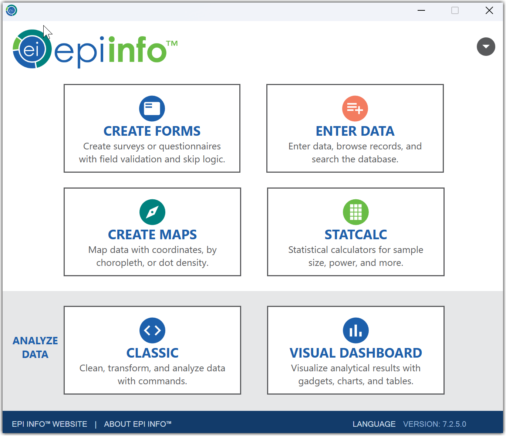

# Installation et configuration d'Epi Info 7 {#sec-installationConfig}

Dans ce chapitre, nous allons télécharger le logiciel Epi Info sur le site internet du CDC, à l’adresse <https://www.cdc.gov/epiinfo/support/downloads.html>, puis l’installer sur notre ordinateur et l’afficher en français.

## Configuration requise

Epi Info 7 fonctionne sous Microsoft Windows 7 ou une version plus récente et nécessite le composant Microsoft .NET Framework 4.8, déjà présent sur les versions récentes de Windows. La version utilisée dans ce livre est la version 7.2 ; les captures d’écran ont été réalisées avec la version 7.2.5.

::: {.callout-note title="À retenir"}

Le CDC a annoncé l’arrêt du développement et de l’assistance technique d’Epi Info à partir du 1^er^ septembre 2025. La dernière version reste téléchargeable et utilisable gratuitement, mais elle ne recevra plus de mises à jour.

:::

## Télécharger et installer Epi Info 7

Le logiciel est distribué sous la forme d’un fichier compressé (`.zip`) qui ne demande pas d’installation classique. Pour l’installer :

1.  Ouvrir la page de téléchargement indiquée plus haut et cliquer sur le lien de téléchargement du fichier ZIP d’Epi Info 7 ;
2.  Une fois le téléchargement terminé, faire un clic droit sur le fichier compressé puis choisir **Extraire tout…** ;
3.  Choisir un emplacement facile à retrouver, par exemple `C:\Epi Info 7`, puis valider. Évitez de laisser le dossier dans `Téléchargements` ;
4.  Ouvrir le dossier extrait et double-cliquer sur le fichier `Launch Epi Info 7.exe` pour lancer le logiciel ;
5.  Pour retrouver facilement le logiciel, faire un clic droit sur ce fichier puis **Envoyer vers \> Bureau (créer un raccourci)**.

::: {.callout-tip title="Conseil"}

Au premier lancement, Windows peut afficher un avertissement de sécurité. Après avoir vérifié que le fichier provient bien du site du CDC, cliquez sur **Informations complémentaires** puis sur **Exécuter quand même**.

:::

## Mettre Epi Info en français

Lorsque nous lançons Epi Info pour la première fois, il s’affiche comme sur la @fig-epiintro.

{#fig-epiintro width="85%"}

Nous remarquons que le logiciel s’affiche en anglais. Pour le passer en français :

1.  Cliquer en bas à droite de la fenêtre d’accueil sur **[language]{.smallcaps}** ;
2.  Dans la fenêtre qui s’ouvre, choisir **French (France)** ;
3.  Cliquer sur **Apply** pour appliquer le changement ;
4.  Fermer puis relancer le logiciel.

Epi Info s’affiche désormais en français. Dans la suite de ce livre, les noms des menus et des boutons sont donc donnés en français. Certains éléments restent toutefois en anglais même après ce changement ; nous les signalerons au fur et à mesure.
