# Créer les champs d'un questionnaire {#sec-creerQuestionnaire}

La création d’un questionnaire, ou formulaire, est une étape très importante dans la conduite d’une enquête. Vous devez au préalable élaborer votre plan de recueil des données et préparer vos questions. Dans le cadre d’un mémoire ou d’une thèse, ce travail se prépare en amont avec votre directeur ou directrice de mémoire ou de thèse, et le questionnaire doit figurer dans votre protocole de recherche. Nous allons maintenant apprendre à créer des questionnaires avec Epi Info 7.

Lançons Epi Info 7, qui s’affiche désormais en français. Le logiciel comporte plusieurs modules :

-   **[créer questionnaires]{.smallcaps}**, qui, comme son nom l’indique, permet de créer des questionnaires ;
-   **[saisir des données]{.smallcaps}**, pour saisir les données ;
-   **[créer des cartes]{.smallcaps}**, pour cartographier les données ;
-   **[statcalc]{.smallcaps}**, pour le calcul de la taille des échantillons ;
-   **[classique]{.smallcaps}** et **[tableau de bord visuel]{.smallcaps}**, pour l’analyse statistique des données.

Cliquons sans tarder sur le module **[créer questionnaires]{.smallcaps}** (@fig-creerquestionnaire).

{#fig-creerquestionnaire}

## Créer un projet {#sec-creerProjet}

Une fois dans le module **[créer questionnaires]{.smallcaps}**, nous allons créer un projet qui contiendra notre ou nos formulaires. En effet, un même projet peut contenir plusieurs formulaires d’une enquête.

Après avoir cliqué sur l’onglet **Nouveau projet**, une fenêtre s’ouvre avec des champs à remplir. Nous saisissons le nom du projet, une description si besoin et enfin le nom du formulaire. Ici, nous avons choisi de nommer notre projet COVID19 : le nom doit être écrit d’un seul tenant, sans espace ni caractère spécial. Dans la partie **Données**, le format proposé par défaut est **Microsoft Access 2002-2003 (.mdb)**. Nous le conservons ; on pourrait aussi choisir **Microsoft SQL Server Database** ou tout autre système que l’on maîtrise bien. Nous validons ensuite la création du projet par **OK** (@fig-nouveauprojet).

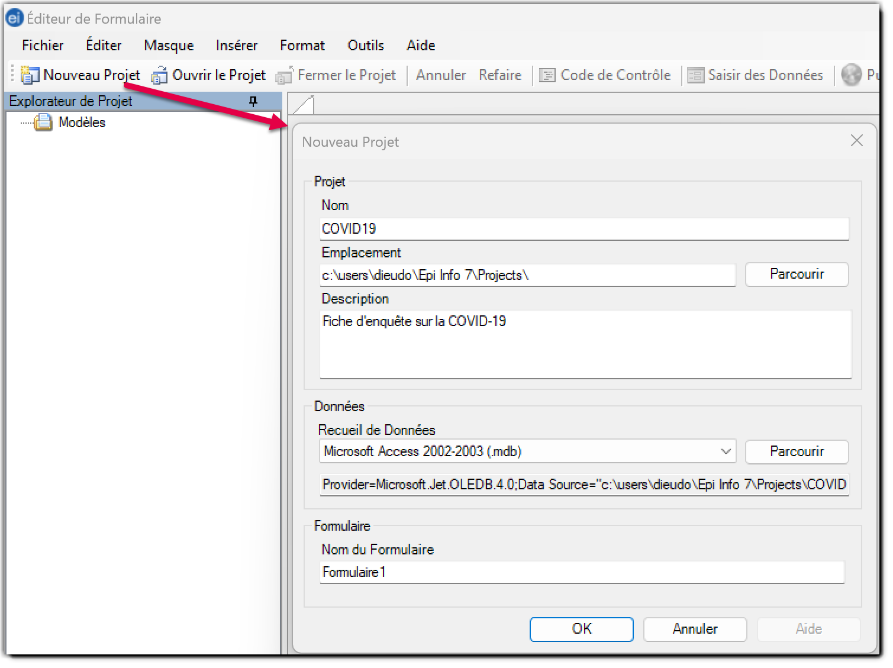{#fig-nouveauprojet}

Une nouvelle fenêtre s’ouvre alors et nous pouvons éditer notre formulaire. Elle présente trois parties : la barre d’outils, l’explorateur de projets et le canevas (@fig-menuaccueilprojet).

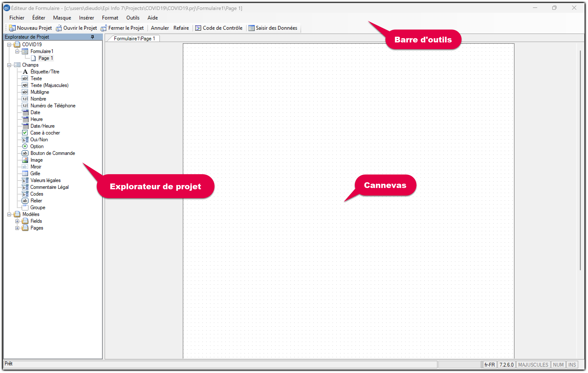{#fig-menuaccueilprojet}

Une fois le projet créé, nous allons créer les champs de notre questionnaire.

## Règles de nommage des variables {#sec-typo}

Pour nommer nos variables, nous utiliserons une convention d’écriture : le *camel case* ou le *snake case*.

Le *camel case*[^02-1] consiste à écrire un ensemble de mots en les liant sans espace ni ponctuation, et en mettant en capitale la première lettre de chaque mot. La première lettre du premier mot peut être en minuscule ou en majuscule. Par exemple : satisfactionClient ou SatisfactionClient (@fig-camelcase).

::: {#fig-camelcase layout-ncol=2}

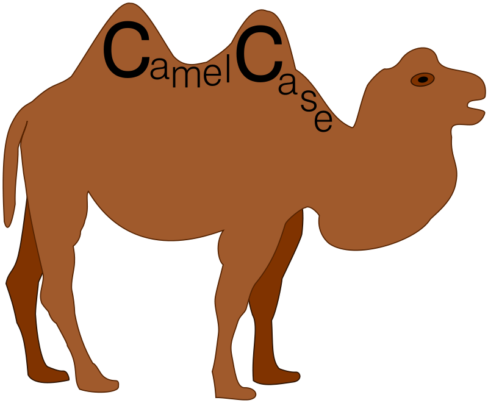

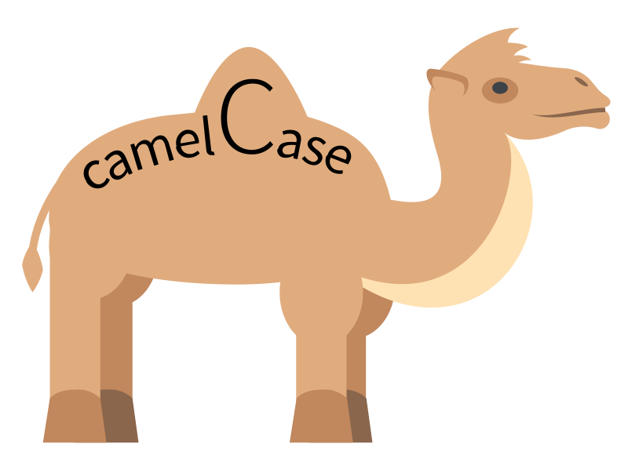

Le camel case : première lettre en majuscule (à gauche) ou en minuscule (à droite)

:::

Le *snake case*[^02-2] consiste quant à lui à écrire les mots, généralement en minuscules, en les séparant par des tirets bas. Ces deux conventions ne sont pas les seules possibles, mais ce sont les plus répandues.

::: {.callout-important title="Important"}

-   Utiliser le camel case ou le snake case pour les noms de variables ;
-   Éviter les noms très longs ;
-   Employer des noms explicites : revenuAnnuel ou revenu_annuel plutôt que revAnnuel ou rev_annuel ;
-   Ne pas commencer un nom de variable par un chiffre ;
-   Ne pas utiliser les mots réservés du logiciel. Un mot réservé se reconnaît à sa coloration rouge ; heureusement, Epi Info désactive la création du champ si un mot réservé est utilisé.

:::

## Comment ajouter un champ

Il existe plusieurs types de champs selon le type de variable à recueillir : texte, nombre, date, case à cocher, valeurs légales, etc. Il y a trois façons d’ajouter un champ :

-   double-cliquer sur le type de champ voulu dans l’explorateur de projets ;
-   faire un glisser-déposer : cliquer sur le type de champ, maintenir le bouton de la souris enfoncé et déposer le champ sur le canevas ;
-   faire un clic droit sur le canevas, puis choisir le type de champ voulu dans le menu **Nouveau champ**.

C’est la première méthode, le double-clic, que nous utiliserons dans ce livre pour nos illustrations.

## Ajouter une étiquette

Pour débuter notre questionnaire, nous avons besoin d’un titre. Pour le créer, nous procédons comme suit :

1.  Double-cliquer sur **Étiquette/Titre** dans l’explorateur de projets ;
2.  Une fenêtre nommée Étiquette/Titre s’ouvre ;
3.  Saisir dans le champ **Question ou Invite** le titre du questionnaire, ici « Enquête Covid-19 » ;
4.  Appuyer sur la touche de tabulation du clavier. Le curseur passe dans le champ **Nom du champ** et le remplit automatiquement à partir de ce que vous avez saisi dans l’invite ;
5.  Vérifier le nom du champ proposé et le corriger si besoin, conformément aux règles de nommage (section [-@sec-typo]). Remarquez qu’Epi Info supprime les lettres accentuées : pour notre titre, il propose `Enqute_Covid19` ;
6.  Valider par **OK** (@fig-ajoutetiquette).

::: {.callout-tip title="Conseil"}

Cliquez sur le bouton **Police**, en bas de la fenêtre, pour changer de police, augmenter la taille des caractères ou mettre le titre en gras.

:::

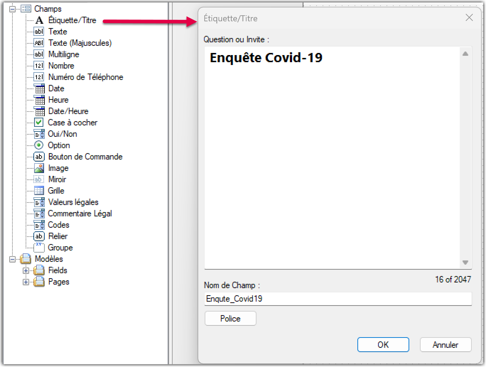{#fig-ajoutetiquette}

Utilisez la souris pour placer le texte sur le canevas. Pour modifier ensuite le titre ou la taille de la police, faites un clic droit sur le champ puis choisissez **Propriétés** : vous retrouvez la fenêtre initiale.

## Ajouter un champ de type texte

Un champ texte est un champ dans lequel on écrit du texte libre : nom, prénom, adresse, etc. Pour ajouter un champ de type texte, procéder comme suit :

1.  Double-cliquer sur **Texte** dans l’explorateur de projets ;
2.  Une fenêtre nommée Texte s’ouvre ;
3.  Taper **Nom** dans le champ **Question ou Invite**. C’est ce libellé qui s’affichera sur le questionnaire : c’est l’étiquette de la question ;
4.  Appuyer sur la touche de tabulation. Le curseur passe dans le champ **Nom du champ** et le remplit automatiquement à partir de l’invite ;
5.  Réécrire le nom du champ, qui correspond au nom de la variable, conformément aux règles de nommage ;
6.  Dans les attributs, cocher **Requis** rend le champ obligatoire. Réfléchissez-y avant de cocher cette case ;
7.  Valider par **OK** (@fig-ajoutchamptexte).

::: {.callout-warning title="Avertissement"}

Par défaut, Epi Info construit le nom de la variable à partir du texte saisi dans le champ Question ou Invite. Il faut donc corriger le nom du champ pour obtenir un nom de variable cohérent, comme vu à la section [-@sec-typo], *Règles de nommage des variables*.

:::

Nous procédons de la même façon avec les champs **Texte (Majuscules)** et **Multiligne**. Comme le champ **Texte**, ce sont des champs dans lesquels on saisit du texte brut.

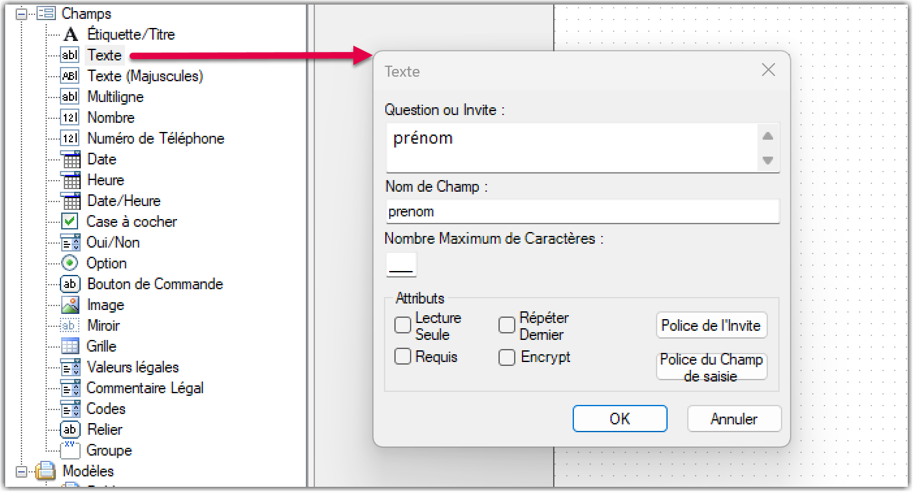{#fig-ajoutchamptexte}

## Ajouter un champ de type numérique {#sec-champNumerique}

Dans un champ texte, l’utilisateur peut saisir n’importe quelle valeur. Ce type de champ ne convient donc pas pour recueillir certaines données comme l’âge ou la température d’un patient au moment de l’entretien. Un champ numérique garantit que seuls des nombres valides sont acceptés. C’est indispensable lors de l’analyse, par exemple pour calculer une moyenne, une médiane, un mode ou les valeurs minimale et maximale.

Les champs de type numérique sont les champs **Nombre** et **Numéro de téléphone**. Prenons l’exemple du champ Nombre avec la variable âge :

1.  Double-cliquer sur **Nombre** dans l’explorateur de projets. Une fenêtre nommée Nombre apparaît ;
2.  Dans le champ **Question ou Invite**, écrire « Âge » ;
3.  Appuyer sur la touche de tabulation. Le curseur passe dans le champ **Nom du champ** et le remplit automatiquement à partir de l’invite ;
4.  Corriger le nom du champ, ici `age` ;
5.  Dans la liste déroulante **Modèle**, sélectionner \###[^02-3] ;
6.  Cocher l’attribut **Lecture seule** si l’âge doit être calculé automatiquement à partir de la date de naissance et de la date de l’enquête. Nous verrons comment au chapitre [-@sec-codeValidation], *Utiliser le code de contrôle*.

De la même façon, nous créons les champs `poids_kg` et `taille_cm` avec le modèle \### (trois dièses) : chez l’être humain, la taille en centimètres comme le poids en kilogrammes ne dépassent pas trois chiffres.

Nous pouvons limiter les erreurs de saisie en définissant un intervalle de valeurs acceptables. Pour le champ `taille_cm`, cocher la case **Intervalle** puis remplir les bornes inférieure et supérieure, ici respectivement 0 et 300 (@fig-ajoutchampnombre). Nous supposons ici qu’une taille humaine est comprise entre 0 et 300 cm ; vous ajusterez ces bornes en fonction de votre public cible.

Nous créons enfin un champ numérique nommé `imc`. La procédure est la même, mais nous cochons l’attribut **Lecture seule** : nous ne voulons pas calculer l’IMC à la main, mais le faire déduire automatiquement du poids et de la taille. Nous verrons comment programmer ce calcul au chapitre [-@sec-codeValidation], *Utiliser le code de contrôle*.

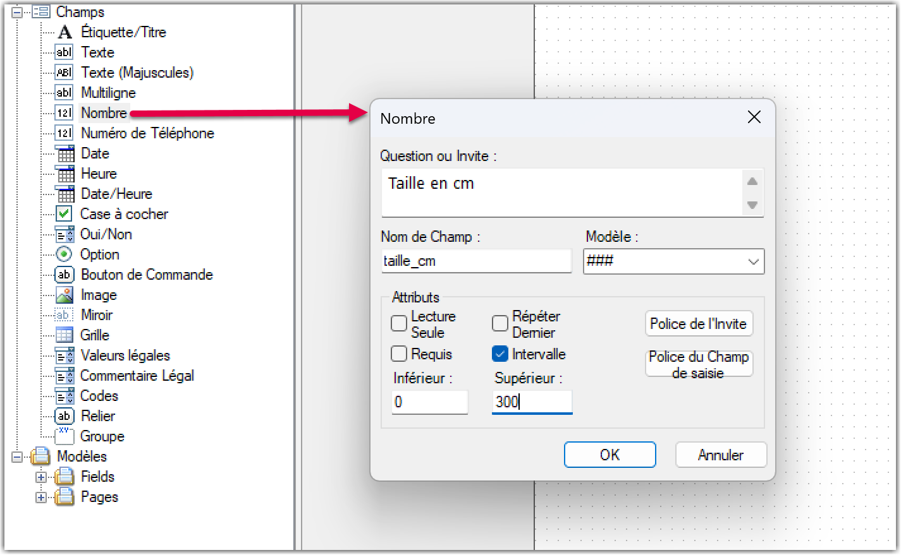{#fig-ajoutchampnombre}

## Ajouter un champ de type date ou heure

Nous présentons ici l’ajout d’un champ de type Date ; la procédure est la même pour les champs de type Date/Heure et Heure. Nous créons ainsi les champs `date_naissance` et `date_enquete`.

1.  Double-cliquer sur **Date**. Une fenêtre nommée Date s’ouvre ;
2.  Saisir la question dans la case prévue à cet effet ;
3.  Corriger le nom du champ si besoin ;
4.  Dans les attributs, cocher **Requis** pour rendre le champ obligatoire, **Lecture seule** si aucune modification ne doit être possible, ou **Intervalle** pour définir une plage de dates acceptables. Modifier la police si besoin ;
5.  Valider par **OK** pour créer le champ (@fig-ajoutchampdate).

Pour la date de naissance (@fig-ajoutchampdate), nous avons coché **Intervalle** avec pour bornes le 29/09/1900 et le 29/09/2023, date de création du formulaire : une date de naissance située dans le futur sera ainsi refusée.

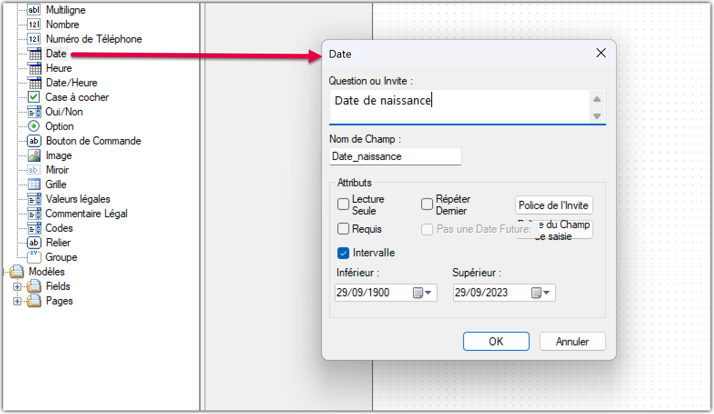{#fig-ajoutchampdate}

## Ajouter un champ de type Oui/Non

Le champ Oui/Non est un champ de type booléen[^02-4] : il répond à une question par Oui ou Non. C’est ce type de champ que nous utilisons pour la question « Êtes-vous vacciné(e) ? » (variable `vaccination`).

1.  Double-cliquer sur **Oui/Non**. Une fenêtre nommée Oui/Non s’ouvre ;
2.  Saisir la question dans la case prévue à cet effet ;
3.  Corriger le nom du champ si besoin ;
4.  Dans les attributs, cocher **Requis** pour rendre le champ obligatoire, **Lecture seule** si aucune modification ne doit être possible, et modifier la police si besoin ;
5.  Valider par **OK** pour créer le champ (@fig-ajoutchampouinon).

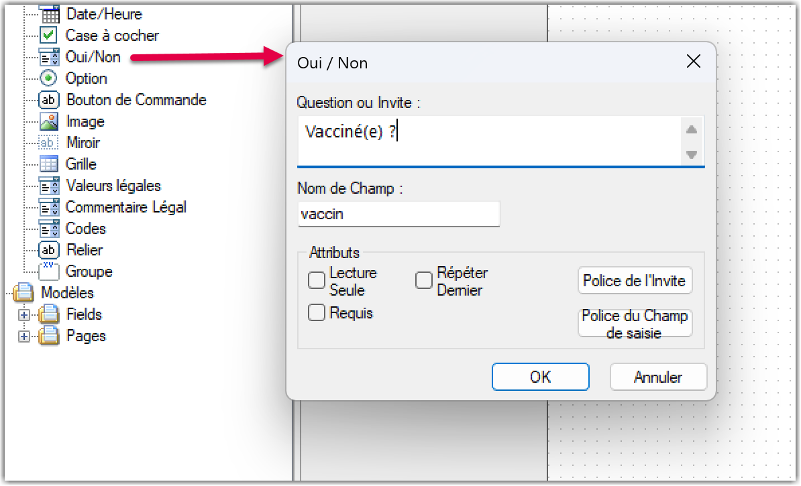{#fig-ajoutchampouinon}

## Ajouter un champ de type case à cocher

Ce type de champ sert aux questions à choix multiples, c’est-à-dire aux questions qui admettent plusieurs réponses. Chaque réponse possible est une case à cocher distincte. Pour la question sur les symptômes, nous créons ainsi les cases **Fièvre**, **Céphalées**, **Toux**, **Mal de gorge**, **Perte de l’odorat/du goût**, **Fatigue**, **Nausées/Vomissements** et **Diarrhée**.

Double-cliquer sur **Case à cocher** et saisir le libellé de la réponse, puis valider par **OK**. S’il existe huit réponses possibles, vous répéterez l’opération huit fois. La @fig-ajoutcaseacocher montre la création du champ **Fièvre**.

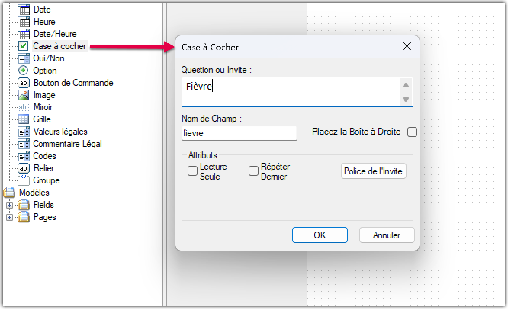{#fig-ajoutcaseacocher}

Créées ainsi, les cases à cocher restent isolées les unes des autres. Nous allons donc les rassembler sous une bannière qui correspond à la question posée : c’est ce que l’on appelle la création d’un groupe (section suivante).

## Créer un groupe {#sec-creerGroupe}

Comme nous venons de le voir, l’option **Groupe** permet de rassembler plusieurs champs sous une même bannière. Il peut s’agir des cases à cocher d’une question à choix multiples, mais aussi, par exemple, des champs nom, prénom, âge, sexe et profession du patient, regroupés sous l’intitulé *Caractéristiques sociodémographiques*.

Pour grouper des champs :

1.  Sélectionner tous les champs du groupe[^02-5] ;
2.  Cliquer sur **Insérer** dans la barre d’outils, puis sur **Groupe** (@fig-ajoutgroupe) ;
3.  Saisir l’intitulé du groupe dans **Question ou Invite**, ici « Symptômes », et vérifier le nom du champ, ici `symptomes` ;
4.  Changer la police si besoin ;
5.  Valider la création du groupe en cliquant sur **OK**.

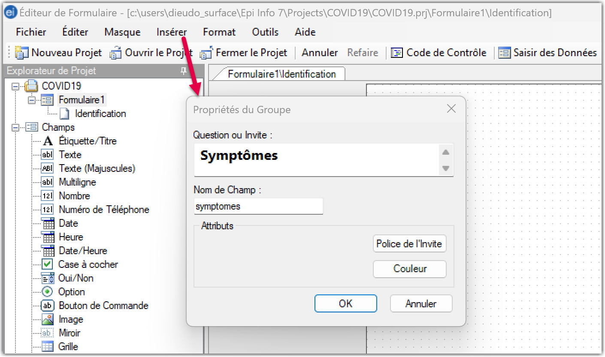{#fig-ajoutgroupe}

::: {.callout-important title="Important"}

Pour créer un groupe, commencez toujours par créer les champs qui le composent (les cases à cocher d’une question à choix multiples, par exemple). Pour supprimer un groupe, faites un clic droit sur le groupe puis choisissez **Supprimer**.

:::

## Ajouter un champ de type valeurs légales {#sec-valeursLegales}

Le champ **Valeurs légales** présente les réponses possibles à une question sous la forme d’une liste déroulante. C’est l’un des moyens les plus simples d’assurer une saisie exacte. Il est très utile lorsque la réponse ne peut prendre qu’un nombre limité de valeurs (@fig-ajoutvaleurslegales).

1.  Double-cliquer sur **Valeurs légales**. Une fenêtre nommée Valeurs légales s’ouvre ;
2.  Saisir la question dans le champ **Question ou Invite** et changer la police si besoin. Notre question est « Pourquoi n’êtes-vous pas vacciné(e) ? » ;
3.  Appuyer sur la touche de tabulation et corriger le nom du champ, ici `pourquoi_pas_vaccine` ;
4.  Dans la partie **Source de données**, cliquer sur le petit carré contenant trois points ;
5.  Dans la fenêtre **Définir le code / les liens légaux** qui s’ouvre, cliquer en bas sur **Créer un nouveau** ;
6.  Saisir les réponses possibles dans la zone qui apparaît, ici **Je ne vois pas la nécessité de me faire vacciner**, **Je ne fais pas confiance au vaccin** et **Autre réponse**. Par défaut, les réponses sont triées par ordre alphabétique ; cocher la case **Ne pas trier**, en bas à gauche, pour conserver l’ordre de saisie ;
7.  Valider le tout par **OK**.

Pour permettre de préciser une « autre réponse », nous créons aussi un champ texte nommé `autre_reponse_non_vaccination`, avec pour invite « Autre réponse liée à la non-vaccination ». Nous l’utiliserons au chapitre [-@sec-codeValidation].

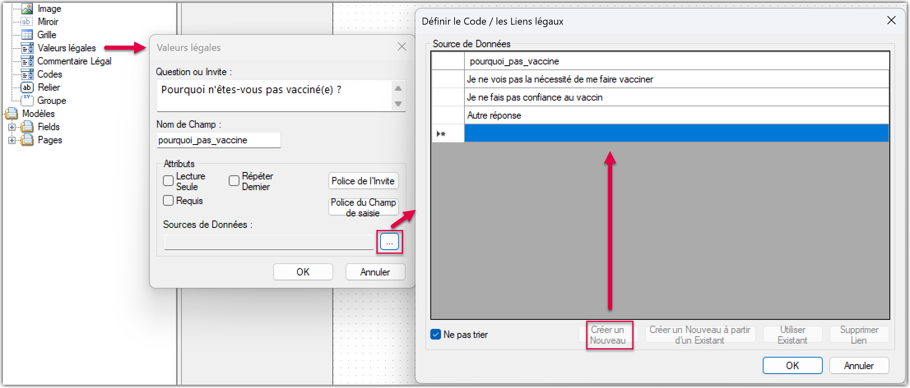{#fig-ajoutvaleurslegales}

## Ajouter un champ de type option {#sec-option}

Le champ **Option** affiche des boutons radio et n’autorise qu’une seule réponse. Nous vous montrons comment l’utiliser, mais c’est un type de champ qu’il vaut mieux éviter (voir l’avertissement ci-dessous). Par exemple, la question précédente, « Pourquoi n’êtes-vous pas vacciné(e) ? », aurait pu être posée avec un champ Option plutôt qu’avec un champ Valeurs légales (section [-@sec-valeursLegales]).

C’est ce que montre la @fig-ajoutchampoption, avec les trois réponses possibles :

1.  Double-cliquer sur **Option**. Une fenêtre nommée Option s’ouvre ;
2.  Saisir la question dans le champ **Question ou Invite**, ici « Pourquoi n’êtes-vous pas vacciné(e) ? », et changer la police si besoin ;
3.  Appuyer sur la touche de tabulation et corriger le nom du champ si besoin, ici `pourquoi_pas_vaccine` ;
4.  Choisir d’afficher les options verticalement (choix par défaut) ou horizontalement ;
5.  Choisir de commencer la liste des options à gauche (choix par défaut) ou à droite ;
6.  Dans les attributs, au niveau de **Nombre de choix**, choisir avec les flèches le nombre de réponses possibles, ici 3 ;
7.  Dans la partie **Définition d’options**, saisir les trois réponses, puis valider par **OK**.

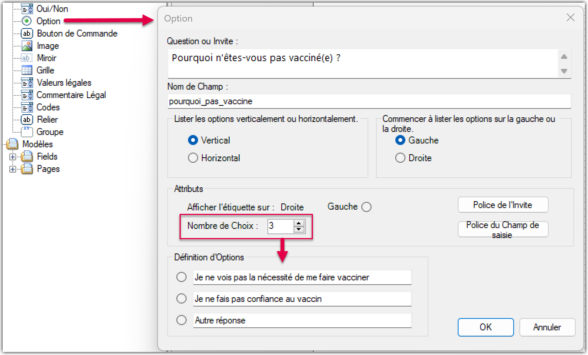{#fig-ajoutchampoption}

::: {.callout-warning title="Avertissement"}

Utiliser un champ Option peut avoir des conséquences graves sur vos données. En effet, un champ Option n’enregistre pas le libellé de la réponse dans la base de données, mais sa position dans la liste. Si la question sur la vaccination était posée avec un champ Option, **Je ne vois pas la nécessité de me faire vacciner** serait enregistré sous la valeur 0, **Je ne fais pas confiance au vaccin** sous la valeur 1, etc. Si, pour une raison ou une autre, vous modifiez ensuite l’ordre des réponses de sorte que **Autre réponse** passe en première position, cette réponse prendra la valeur 0… mais les données déjà enregistrées ne seront pas mises à jour. Il est donc recommandé d’utiliser les listes déroulantes (Valeurs légales, Commentaire légal, etc.) plutôt que les champs Option.

:::

## Ajouter un champ de type commentaire légal {#sec-commentaireLegal}

Comme le champ Valeurs légales, le champ **Commentaire légal** présente les réponses possibles sous la forme d’une liste déroulante. La différence est que chaque réponse est précédée d’un code, alphabétique ou numérique ; le code et la réponse sont reliés par un trait d’union ($-$). C’est le code qui est enregistré dans la base de données, ce qui facilite l’analyse. Prenons l’exemple de la situation matrimoniale (@fig-ajoutcommentairelegal) :

1.  Double-cliquer sur **Commentaire légal**. Une fenêtre nommée Commentaire légal s’ouvre ;
2.  Saisir la question dans le champ **Question ou Invite** et changer la police si besoin ;
3.  Appuyer sur la touche de tabulation et corriger le nom du champ si besoin, par exemple `situation_matrimoniale` ;
4.  Dans la partie **Source de données**, cliquer sur le petit carré contenant trois points, situé en bas à droite ;
5.  Dans la fenêtre **Définir le code / les liens légaux** qui s’ouvre, cliquer en bas sur **Créer un nouveau** ;
6.  Saisir les réponses, chacune précédée de son code, dans la zone qui apparaît. Dans notre cas : **C-Célibataire**, **M-Marié(e)** et **D-Divorcé(e)** ;
7.  Valider le tout par **OK**.

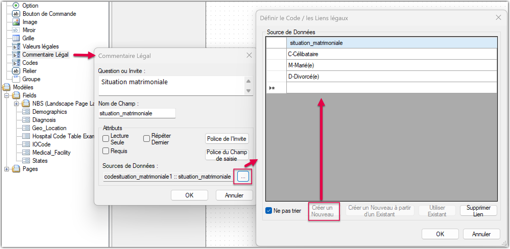{#fig-ajoutcommentairelegal}

::: {.callout-note title="À retenir"}

Il est également possible de reproduire cet exemple avec un champ Valeurs légales (voir la section [-@sec-valeursLegales], *Ajouter un champ de type valeurs légales*), mais sans les codes.

:::

## Ajouter un champ de géolocalisation

Il est possible d’ajouter un champ de géolocalisation dans Epi Info. Pour cela :

-   aller dans **Modèles**, en bas de l’explorateur de projets (la barre latérale gauche) ;
-   ouvrir le dossier **Fields** ;
-   faire un glisser-déposer de **Geo_Location** sur le canevas (@fig-geolocalisation).

Ce modèle ajoute au formulaire les champs nécessaires pour enregistrer la latitude et la longitude du lieu de l’enquête.

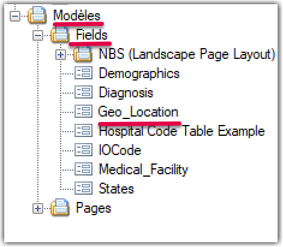{#fig-geolocalisation width="50%"}

## Les attributs de champ

Vous avez sans doute remarqué que la fenêtre de définition d’un champ numérique diffère de celle d’un champ texte. Par exemple, le champ texte ne propose ni intervalle ni modèle. Chaque type de champ dispose en effet de ses propres options pour personnaliser son apparence et son comportement. Parmi les attributs les plus courants figurent :

-   **Intervalle** : permet de fixer une valeur minimale et une valeur maximale pour le champ. Toute valeur en dehors de ces bornes est refusée ;
-   **Requis** : un champ obligatoire doit être rempli avant que l’enregistrement puisse être sauvegardé ;
-   **Répéter le dernier** : le champ est automatiquement rempli avec la valeur de l’enregistrement précédent ;
-   **Lecture seule** : le champ ne peut pas être modifié par l’utilisateur. Cet attribut sert surtout aux champs calculés par le code de contrôle, comme l’âge ou l’IMC.

## L'outil dictionnaire des données

Le dictionnaire des données est un résumé des champs créés. Il indique notamment, pour chaque champ, le numéro de la page, l’invite, le nom du champ, son type, sa mise en forme éventuelle et toute autre information qui lui est propre. Il est essentiel de relire le dictionnaire des données avant de commencer la collecte : cela permet de repérer les noms de champs mal choisis et de vérifier que chaque champ a le bon type et le bon format.

Pour afficher le dictionnaire, cliquer sur **Outils** dans la barre d’outils, puis sur **Dictionnaire des données**. Le dictionnaire peut être trié en cliquant sur le titre de chaque colonne. Il peut aussi être affiché dans un navigateur web et imprimé avec la commande d’impression du navigateur ou le raccourci clavier **Ctrl + P**.

## Ajouter, renommer ou supprimer une page {#sec-ajouterPage}

Un formulaire peut contenir plusieurs pages. Notre formulaire en compte deux : la page **Identification** et la page **Signes cliniques**.

Pour ajouter une page, faire un clic droit sur le nom du formulaire dans l’explorateur de projets et cliquer sur **Ajouter une page** (@fig-ajouterpage). Pour supprimer ou renommer une page, faire un clic droit sur la page concernée puis choisir **Supprimer** ou **Renommer**.

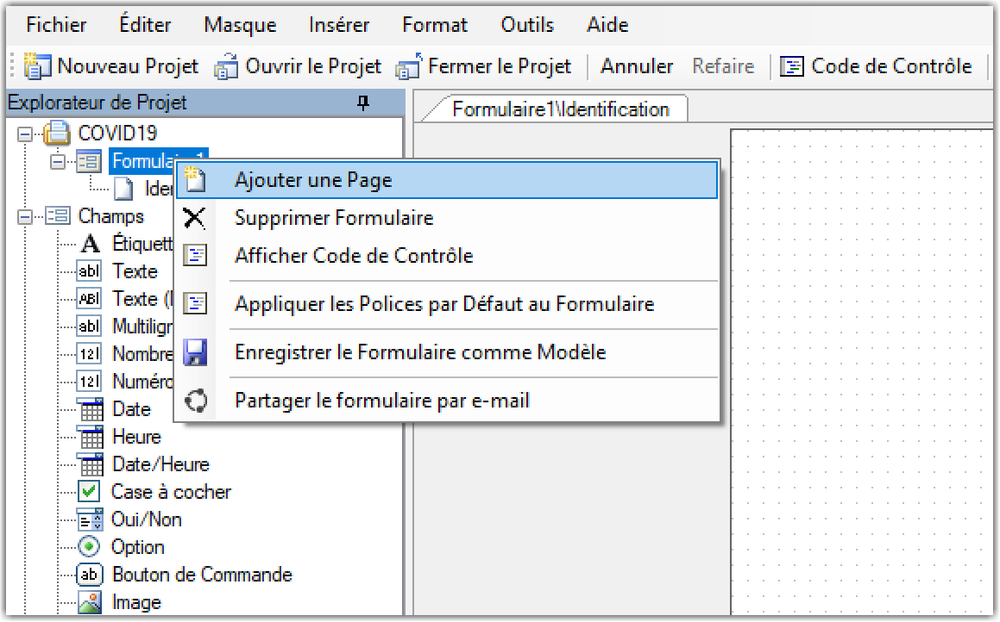{#fig-ajouterpage}

## Changer l'ordre de tabulation

Notre formulaire se présente comme sur la @fig-formulairepage1, et la @fig-formulairepage2.

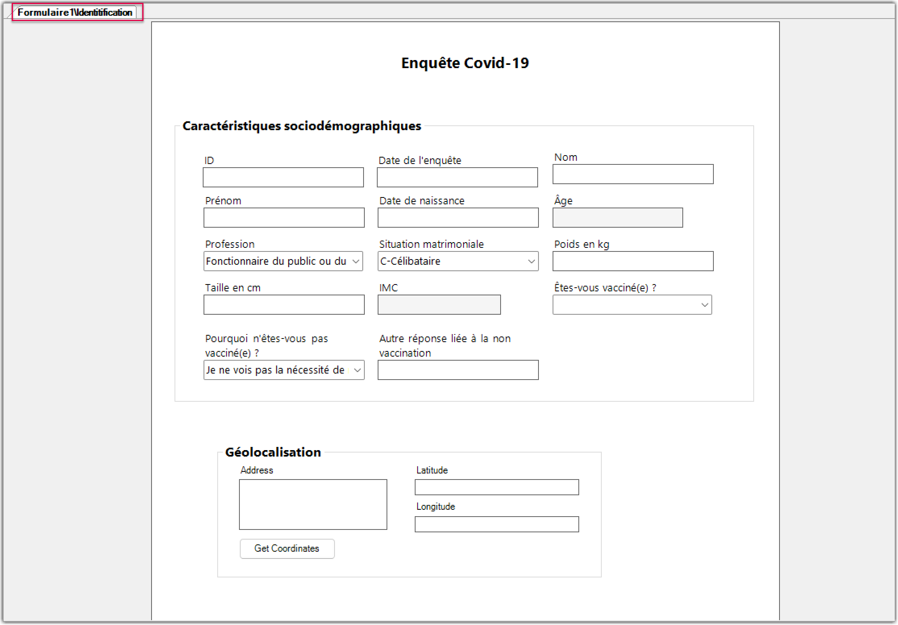{#fig-formulairepage1}

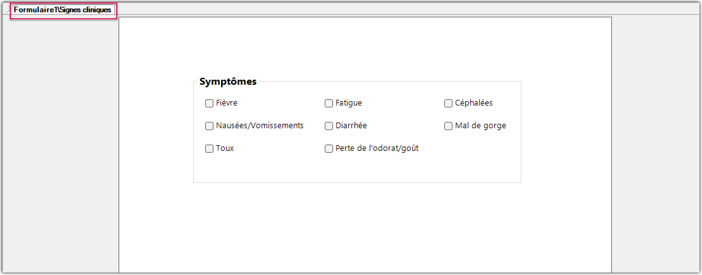{#fig-formulairepage2}

L’ordre de tabulation est l’ordre dans lequel le curseur passe d’un champ à l’autre lorsque l’on appuie sur la touche Tabulation pendant la saisie. Il est fixé par défaut selon l’ordre de création des champs. Après réorganisation du formulaire sur le canevas, cet ordre ne correspond donc souvent plus à la disposition des questions.

Affichons d’abord l’ordre de tabulation actuel : faire un clic droit sur le canevas, aller dans **Onglets** puis cliquer sur **Montrer l’ordre des tabulations** (@fig-afficherordretabulation). La @fig-ordretabulation montre l’ordre de tabulation de notre formulaire. Le vôtre peut être différent.

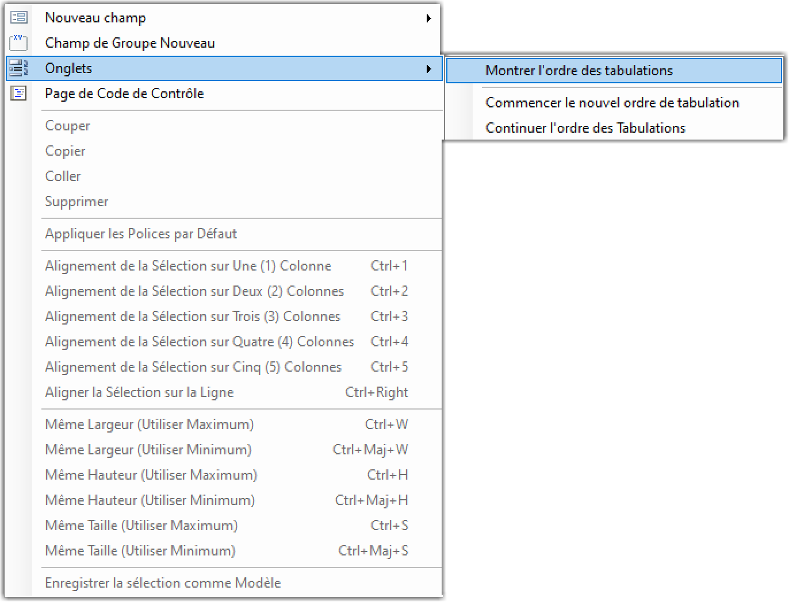{#fig-afficherordretabulation}

{#fig-ordretabulation}

Cet ordre ne nous convient pas ; nous allons donc le réorganiser. Faire de nouveau un clic droit sur le canevas, aller dans **Onglets** et cliquer sur **Commencer le nouvel ordre de tabulation**, puis cliquer sur les champs dans l’ordre souhaité. Pour ne changer l’ordre que de certains champs, cliquer sur le numéro correspondant au champ. La @fig-nouvelordretabulation montre le nouvel ordre.

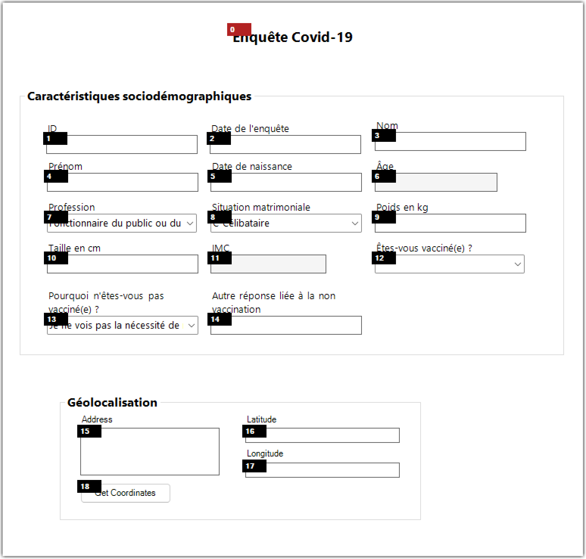{#fig-nouvelordretabulation}

## Utiliser des modèles {#sec-modeles}

Epi Info permet d’enregistrer des éléments d’un formulaire sous forme de modèles pour les réutiliser plus tard. Il existe deux sortes de modèles : le *modèle de champs*, qui ne contient qu’une sélection de champs, et le *modèle de projet*, qui contient le projet entier.

### Créer un modèle de champs

Vous voudrez peut-être réutiliser certains champs dans des formulaires futurs. Plutôt que de recréer les mêmes champs, vous pouvez enregistrer votre sélection comme modèle. Vous gagnerez ainsi du temps et pourrez créer un formulaire très rapidement, en cas d’urgence par exemple. Dans notre cas, nous voulons enregistrer comme modèle les champs nom, prénom, âge, profession, etc., que nous avons regroupés sous la bannière « Caractéristiques sociodémographiques ». Pour créer le modèle :

1.  Sélectionner avec la souris tous les champs à enregistrer, ici le groupe Caractéristiques sociodémographiques ;
2.  Faire un clic droit sur une partie vide du canevas. Un menu contextuel s’ouvre ;
3.  Cliquer sur **Enregistrer la sélection comme modèle**. Une fenêtre nommée Ajouter un modèle apparaît ;
4.  Saisir le nom du modèle, ici **Caractéristiques socio-démographiques** ;
5.  Valider par **OK**.

Le modèle créé apparaît dans l’explorateur de projets, dans la rubrique **Modèles**, puis **Fields** (« champs » en français). La @fig-ajoutmodelechamp montre que notre modèle a bien été créé. S’il n’apparaît pas, cliquer sur le $+$ à gauche de **Modèles** puis de **Fields** pour déplier la liste.

Pour ajouter ce modèle dans un futur formulaire, il suffit de le faire glisser[^02-6] sur le canevas.

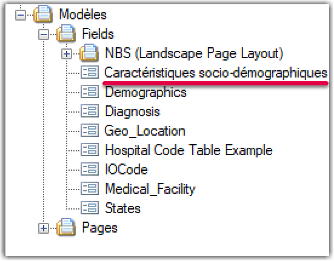{#fig-ajoutmodelechamp width="55%"}

### Créer un modèle de projet {#sec-modeleProjet}

Contrairement au modèle de champs, le modèle de projet englobe l’ensemble du projet : tous ses formulaires, toutes les pages de chaque formulaire et tout le code de contrôle (que nous verrons au chapitre [-@sec-codeValidation]). C’est ce modèle que l’on envoie aux enquêteurs pour qu’ils disposent tous exactement du même questionnaire. Pour créer un modèle de projet à partir de notre projet COVID19 :

1.  Dans l’explorateur de projets, faire un clic droit sur le nom du projet, ici `COVID19`. Un menu contextuel apparaît ;
2.  Sélectionner **Enregistrer le projet en tant que modèle** (*Save Project as Template*). La fenêtre du même nom s’ouvre ;
3.  Taper le nom du modèle, par exemple `ModeleCOVID19`, dans le champ **Nom du modèle** ;
4.  Cliquer sur **OK**.

### Envoyer un modèle de projet à un collègue

Une fois le modèle créé, il apparaît dans l’explorateur de projets, dans la rubrique **Modèles**, sous `Projects`. Il ne reste plus qu’à retrouver le fichier pour le joindre à un courriel ou le copier sur une clé USB :

1.  Repérer le modèle `ModeleCOVID19` sous `Projects` dans l’explorateur de projets. Il faudra peut-être faire défiler le volet vers le bas pour le trouver ;
2.  Faire un clic droit sur `ModeleCOVID19`. Un menu contextuel apparaît ;
3.  Sélectionner **Ouvrir le dossier conteneur** (*Open Containing Folder*). Une fenêtre de l’Explorateur de fichiers de Windows s’ouvre ;
4.  Repérer le fichier `ModeleCOVID19.xml` dans la liste. Ce fichier est le modèle : vous pouvez le joindre à un courriel avec votre messagerie habituelle ou le copier sur une clé USB.

### Charger un modèle de projet reçu d'un collègue

Mettons-nous maintenant à la place d’un enquêteur qui vient de recevoir le fichier `ModeleCOVID19.xml` par courriel. Pour créer le projet à partir de ce modèle :

1.  Enregistrer la pièce jointe sur le bureau de l’ordinateur ;
2.  Ouvrir le module **[créer questionnaires]{.smallcaps}** d’Epi Info 7 ;
3.  Aller dans **Fichier \> Obtenir un modèle…** Une fenêtre Windows d’ouverture de fichier apparaît ;
4.  Aller sur le bureau et sélectionner le fichier reçu ;
5.  Cliquer sur **Ouvrir**. La fenêtre **Nouveau projet à partir d’un modèle** s’ouvre ;
6.  Sélectionner le modèle que vous venez de charger, s’il ne l’est pas déjà ;
7.  Si nécessaire, indiquer un nom de projet dans la zone **Nom** ;
8.  Cliquer sur **OK** pour créer le projet.

L’enquêteur dispose alors d’un projet identique au vôtre, prêt pour la saisie des données.

::: {.callout-tip title="Conseil"}

Créez et envoyez le modèle de projet seulement après avoir testé le questionnaire et son code de contrôle (chapitres [-@sec-codeValidation] et [-@sec-saisirDonnees]). Tous les enquêteurs travailleront ainsi sur la même version, et leurs données pourront être fusionnées sans difficulté.

:::

[^02-1]: Littéralement « casse de chameau ». Cette façon d’écrire est aussi devenue une mode : le marketing en a tiré de nombreuses marques, comme MasterCard, PlayStation ou iPhone.

[^02-2]: Il utilise le tiret bas « \_ », comme dans mon_premier_chapitre.

[^02-3]: \### signifie que la valeur comporte au plus trois chiffres entiers ; ##.## signifie deux chiffres entiers et deux chiffres après la virgule. Le point entre les dièses correspond à la virgule dans la notation anglaise.

[^02-4]: Type informatique dont la valeur est soit vraie (*True*), soit fausse (*False*).

[^02-5]: Pour sélectionner plusieurs champs, tracer un rectangle avec le bouton gauche de la souris maintenu enfoncé jusqu’à encadrer tous les champs.

[^02-6]: Le glisser-déposer consiste à cliquer sur un élément, à le déplacer vers une zone précise en maintenant le bouton de la souris enfoncé, puis à relâcher le bouton.
