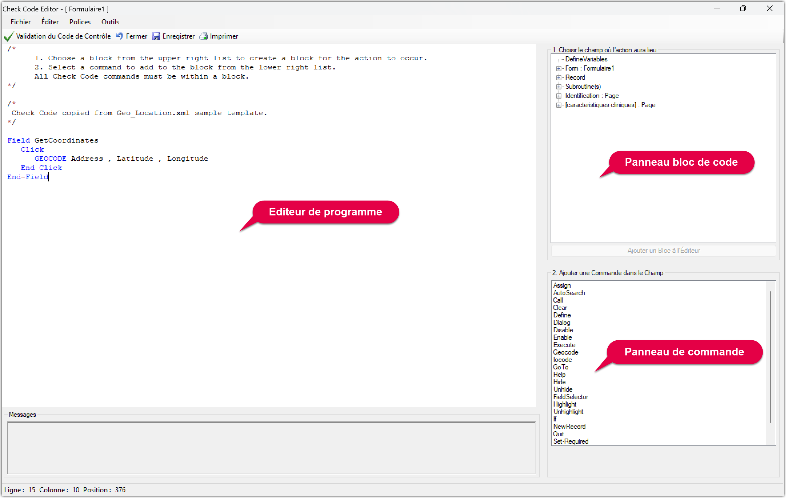
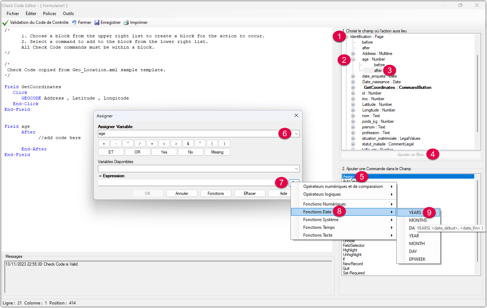
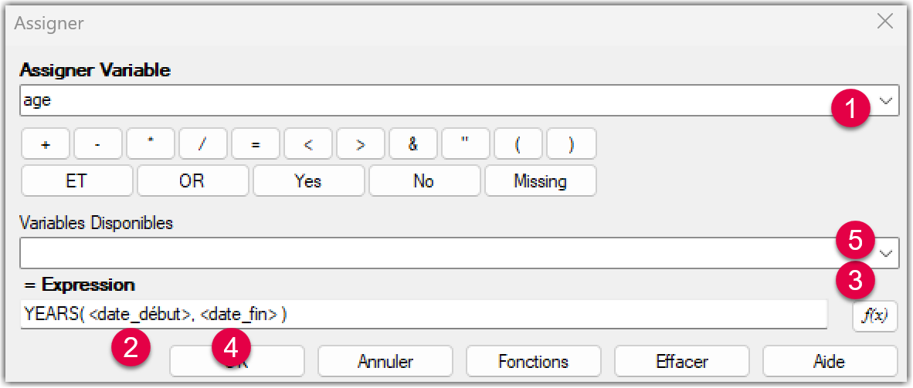
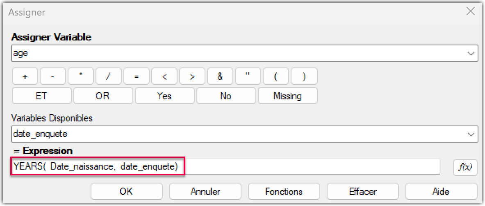
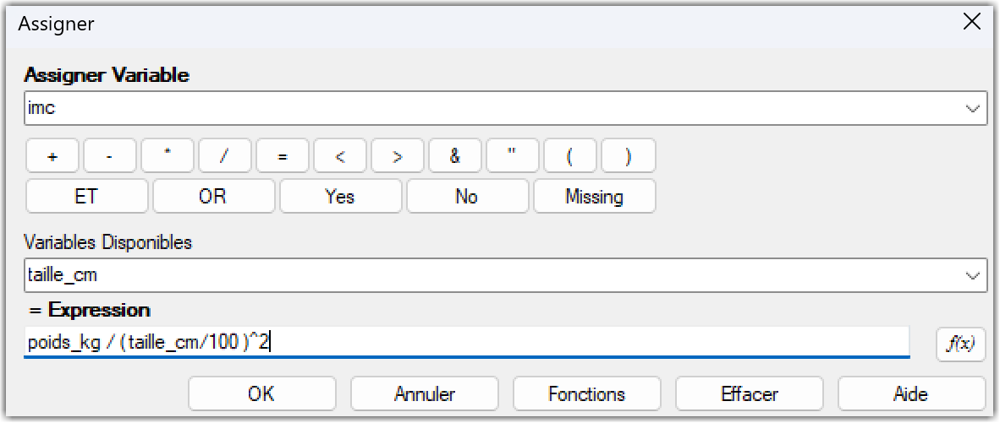
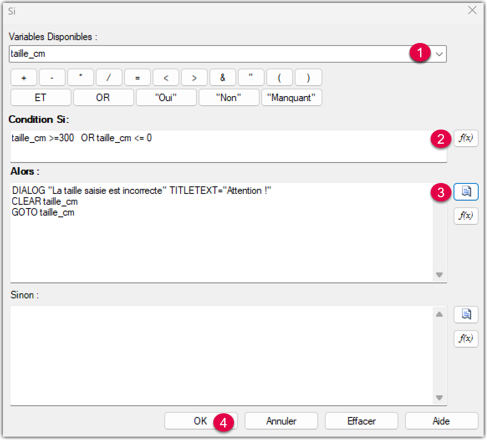
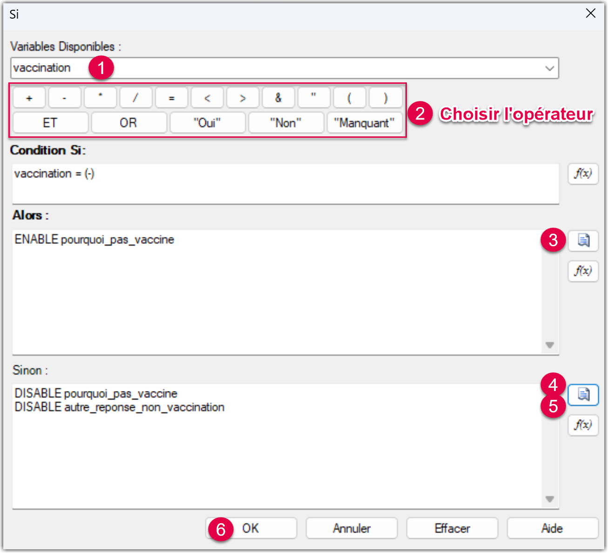
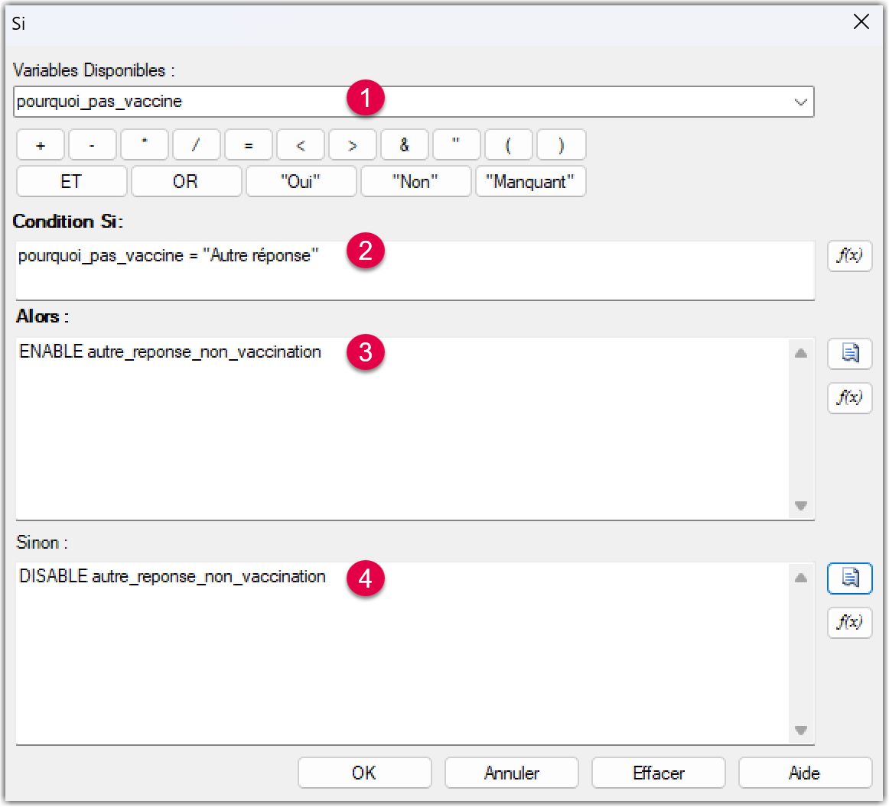

# Utiliser le code de contrôle {#sec-codeValidation}

Epi Info 7 dispose d’un mécanisme de validation des données appelé *Check Code*, ou code de contrôle. Le code de contrôle rend le formulaire plus intelligent : son comportement peut changer au cours de la saisie. Il permet notamment de calculer automatiquement des valeurs comme l’âge ou l’IMC, d’appliquer des sauts de questions, d’afficher des messages ou des questions à l’utilisateur pendant la saisie, de remplir des champs et de masquer des champs. Le code de contrôle se construit à l’aide de boîtes de dialogue disponibles dans le module **[créer questionnaires]{.smallcaps}**. C’est à nous de programmer le comportement que nous voulons donner à notre questionnaire.

## Ouvrir l'éditeur de code de contrôle

Pour accéder au code de contrôle, il faut d’abord ouvrir un formulaire :

1.  Ouvrir Epi Info 7 et aller dans le module **[créer questionnaires]{.smallcaps}** ;
2.  Dans la barre d’outils, cliquer sur **Fichier** puis sur **Ouvrir le projet**. Vous pouvez aussi utiliser le raccourci clavier **Ctrl + O** ;
3.  Aller dans le répertoire des projets d’Epi Info 7 et ouvrir le dossier de notre projet `COVID19`, créé au chapitre [-@sec-creerQuestionnaire] (il faudra peut-être faire défiler la liste pour l’apercevoir) ;
4.  Ouvrir le fichier `COVID19.prj`, par un double-clic ou en le sélectionnant puis en cliquant sur **Ouvrir** ;
5.  Une fois le formulaire ouvert, cliquer sur le bouton **Code de contrôle**, qui ouvre l’éditeur de code de contrôle (@fig-editeurcodevalidation).

{#fig-editeurcodevalidation}

Tout code de contrôle doit être associé à un champ existant du formulaire. Les champs disponibles sont listés, page par page, dans le panneau **Choisir le champ où l’action aura lieu**.

Le code de contrôle repose sur des événements : nous définissons le comportement des champs en fonction d’actions comme l’ouverture ou la fermeture du formulaire, l’ouverture ou la fermeture d’une page, l’entrée du curseur dans un champ (**`Before`**) ou sa sortie (**`After`**).

::: {.callout-note title="À retenir"}

Dans l’éditeur, vous ne verrez pas l’intitulé de vos questions mais le nom des variables, c’est-à-dire ce que vous avez saisi dans **Nom du champ**. D’où l’importance, une fois de plus, de bien nommer ses variables.

:::

## Les principales commandes

Dans ce chapitre, nous voulons calculer automatiquement l’âge de la personne enquêtée à partir de sa date de naissance et de la date de l’enquête. Epi Info 7 calcule la différence entre deux dates en années, en mois ou en jours, avec respectivement les fonctions **`YEARS()`**, **`MONTHS()`** et **`DAYS()`**. De même, au lieu de calculer l’indice de masse corporelle (IMC) à la main, nous voulons le déduire du poids et de la taille. Rappelons que l’IMC est égal au poids en kilogrammes divisé par le carré de la taille en mètres. La taille étant saisie en centimètres, nous la divisons par 100 : $$\text{IMC} = \frac{\mathrm{poids\_kg}}{\left(\mathrm{taille\_cm}/100\right)^2}$$

Voici les commandes du code de contrôle que nous utiliserons le plus :

-   **`DEFINE`** (Définir) : crée une nouvelle variable ;
-   **`ASSIGN`** (Attribuer) : affecte à une variable le résultat d’une opération arithmétique ou d’une expression de texte ;
-   **`HIDE`** (Masquer) : masque un champ pour le rendre invisible ;
-   **`UNHIDE`** (Afficher) : rend visible un champ masqué auparavant ;
-   **`DISABLE`** (Désactiver) : désactive un champ. Un champ désactivé n’accepte aucune saisie et sort de l’ordre de tabulation ;
-   **`ENABLE`** (Activer) : réactive un champ désactivé auparavant ;
-   **`IF`** (Si) : définit une condition et ce qui doit se passer si elle est remplie. Une autre action peut être prévue après l’instruction **`ELSE`** (Sinon) ;
-   **`GOTO`** (Aller à) : seul ou dans une instruction If, envoie le curseur vers un champ ou une page ;
-   **`CLEAR`** (Effacer) : vide le champ indiqué, comme s’il n’avait jamais été rempli ;
-   **`DIALOG`** (Boîte de dialogue) : affiche un message à l’utilisateur.

## La commande Assign

Dans notre questionnaire, l’âge doit être déduit de la date de naissance et de la date de l’enquête, et l’IMC du poids et de la taille. Nous voulons donc affecter aux variables `age` et `imc` une formule de calcul : c’est le rôle de la commande **`ASSIGN`**.

Une fois dans l’éditeur de code de contrôle, procéder comme suit pour remplir automatiquement le champ `age` (@fig-creercodevalidationage) :

1.  Dans le panneau des blocs de code, cliquer sur le $+$ à côté de **Identification : Page** pour déplier les champs de la page Identification (étape 1) ;
2.  Cliquer sur le $+$ à gauche de la variable `age` (étape 2) ;
3.  Cliquer sur **`After`** (étape 3) : l’action aura lieu à la sortie du champ ;
4.  Cliquer sur **Ajouter un bloc** pour ajouter le bloc de code dans l’éditeur de programme (étape 4) ;
5.  Dans le panneau des commandes, cliquer sur la commande **`ASSIGN`**. Une fenêtre apparaît (étape 5) ;
6.  Cliquer sur la flèche déroulante **Assigner variable** et choisir la variable `age` (étape 6) ;
7.  Dans la partie **Expression**, cliquer sur le petit rectangle $f(x)$ (étape 7) ;
8.  Dans le menu qui s’ouvre, aller à **Fonctions Date** (étape 8) ;
9.  Dans le dernier sous-menu, choisir la fonction **`YEARS()`** (étape 9).

{#fig-creercodevalidationage}

L’expression générique de la fonction s’affiche alors : **`YEARS(date_debut, date_fin)`**. Nous la complétons avec nos variables (@fig-ecrituredelalogiqueage) :

1.  Double-cliquer sur `date_debut` pour le sélectionner ;
2.  À l’aide de la flèche déroulante **Variables disponibles**, choisir la variable `date_naissance` ;
3.  Double-cliquer sur `date_fin` ;
4.  Dans la liste **Variables disponibles**, choisir la variable `date_enquete` ;
5.  Valider le tout par **OK** (@fig-codeassign).

{#fig-ecrituredelalogiqueage}

{#fig-codeassign}

Après validation, le code apparaît dans l’éditeur de programme (@lst-assign). Il reste à vérifier que le code est valide en cliquant, en haut à gauche, sur **Valider le code de contrôle**[^03-1], puis à l’enregistrer en cliquant sur **Enregistrer**.

::: {#lst-assign}

```epiinfo
Field age
    After
        //add code here
        ASSIGN age = YEARS(date_naissance, date_enquete)
    End-After
End-Field
```

Utilisation de la fonction YEARS() avec la commande ASSIGN

:::

Nous créons de la même manière le code de contrôle de la variable `imc` (@fig-assignationimc) :

1.  Dans le panneau des blocs de code, chercher la variable `imc`, qui se trouve sur la page Identification du formulaire ;
2.  Cliquer sur le $+$ à gauche de la variable `imc`, puis sur **`After`** ;
3.  Cliquer sur **Ajouter un bloc** ;
4.  Cliquer sur la commande **`ASSIGN`** dans le panneau des commandes et choisir la variable `imc` ;
5.  Dans la partie **Expression**, écrire la formule de l’IMC en vous aidant de la liste **Variables disponibles**. N’oubliez pas de diviser la taille par 100 pour la convertir en mètres, puisque nous avons choisi de recueillir les tailles en centimètres ;
6.  Valider par **OK** : le code apparaît dans l’éditeur de programme (@lst-imc) ;
7.  Vérifier la validité du code en cliquant sur **Valider le code de contrôle** ;
8.  Enregistrer le code en cliquant sur **Enregistrer**.

{#fig-assignationimc}

::: {#lst-imc}

```epiinfo
Field imc
    After
        //add code here
        ASSIGN imc = poids_kg/(taille_cm/100)^2
    End-After
End-Field
```

Code d'assignation de la variable imc

:::

::: {.callout-important title="Important"}

-   En informatique en général, et dans Epi Info en particulier, les opérations arithmétiques s’écrivent $+$, $-$, $*$ et $/$ pour l’addition, la soustraction, la multiplication et la division. Le symbole `^` représente la puissance ;
-   Vérifiez toujours la validité du code ;
-   Enregistrez toujours le code avant de quitter l’éditeur de code de contrôle.

:::

## Les commandes If, Dialog, Clear et GoTo

La commande **`IF`** est utilisée en algorithmique et dans de nombreux langages de programmation pour exécuter une action sous condition. Elle s’emploie le plus souvent sous la forme **`IF`** (condition) **`THEN`** (action) **`ELSE`** (autre action), soit : « si la condition est vérifiée, exécuter ce bloc de code ; sinon, exécuter cet autre bloc ». Passons sans plus tarder à la démonstration.

Nous allons écrire un code simple qui nous alerte si nous saisissons par erreur une taille inférieure ou égale à 0 cm ou supérieure ou égale à 300 cm. Le code affiche alors une fenêtre intitulée « Attention ! » avec le message « La taille saisie est incorrecte », efface la valeur saisie et replace le curseur dans le champ pour une nouvelle saisie. Procédons comme suit (@fig-codeconditionsi) :

1.  Ouvrir l’éditeur de code de contrôle ;
2.  Dans le panneau des blocs de code, chercher la variable `taille_cm`, située sur la page **Identification** du formulaire ;
3.  Cliquer sur le $+$ pour déplier les événements de cette variable ;
4.  Cliquer sur **`After`** puis sur **Ajouter un bloc** ;
5.  Dans le panneau des commandes, cliquer sur la commande **`IF`**. Une fenêtre s’ouvre ;
6.  Écrire la condition dans la case **Condition Si**. On peut s’aider de la liste **Variables disponibles** et du bouton de fonctions $f(x)$ ;
7.  Dans la partie **Alors**, indiquer le code à exécuter lorsque la condition est vérifiée. Ici, nous ajoutons les commandes **`DIALOG`**, **`CLEAR`** et **`GOTO`** en cliquant à chaque fois sur le petit symbole de document, dans le coin droit de la partie **Alors** (étape ➌ de la @fig-codeconditionsi) ;
8.  On peut aussi utiliser la partie **Sinon** (**`ELSE`**) pour indiquer le code à exécuter lorsque la condition n’est pas vérifiée ;
9.  Cliquer sur **OK** pour afficher le code créé dans l’éditeur de programme, puis le valider et l’enregistrer.

{#fig-codeconditionsi}

Le code obtenu est présenté dans le @lst-dialog.

::: {#lst-dialog}

```epiinfo
Field taille_cm
    After
        //add code here
        IF taille_cm >= 300 OR taille_cm <= 0 THEN
            DIALOG "La taille saisie est incorrecte" TITLETEXT="Attention !"
            CLEAR taille_cm
            GOTO taille_cm
        END-IF
    End-After
End-Field
```

Code de contrôle de la variable taille_cm

:::

#### Explication du code {.unnumbered .unlisted}

-   Le code du champ est délimité par **`Field`** (suivi du nom de la variable) et **`End-Field`** ;
-   **`After`** … **`End-After`** indique que le code s’exécute à la sortie du champ. La ligne *//add code here* est un simple commentaire ;
-   La commande If est délimitée par **`IF`** et **`END-IF`** ;
-   La condition **`taille_cm >= 300 OR taille_cm <= 0 THEN`** signifie : SI la taille en centimètres est supérieure ou égale à 300 OU inférieure ou égale à 0, ALORS…;
-   Le corps du bloc contient le code à exécuter, que nous expliquons ligne par ligne :
    -   **`DIALOG`** : ouvre une fenêtre intitulée « Attention ! » qui affiche le message « La taille saisie est incorrecte » ;
    -   **`CLEAR taille_cm`** : efface la valeur saisie dans le champ `taille_cm` ;
    -   **`GOTO taille_cm`** : laisse le curseur dans le champ `taille_cm` afin de pouvoir saisir à nouveau la taille.

## Les commandes Enable et Disable

Nous allons maintenant créer un code de contrôle plus élaboré, qui combine la commande **`IF-ELSE`** avec les commandes **`ENABLE`** et **`DISABLE`**.

Dans notre questionnaire, nous voulons lier les questions « Êtes-vous vacciné(e) ? », « Pourquoi n’êtes-vous pas vacciné(e) ? » et « Autre réponse liée à la non-vaccination ».

::: {.callout-note icon=false title="Description de la logique"}

Si la réponse à la question « Êtes-vous vacciné(e) ? » (variable `vaccination`) est **No** (**Non**), alors le champ « Pourquoi n’êtes-vous pas vacciné(e) ? » (variable `pourquoi_pas_vaccine`) est activé pour permettre de choisir l’une des réponses proposées :

-   Je ne vois pas la nécessité de me faire vacciner ;
-   Je ne fais pas confiance au vaccin ;
-   Autre réponse.

Si la réponse choisie est **Autre réponse**, alors le champ « Autre réponse liée à la non-vaccination » (variable `autre_reponse_non_vaccination`) est activé pour permettre de la préciser.

En revanche, si la réponse à la question « Êtes-vous vacciné(e) ? » est **Yes** (**Oui**), les champs « Pourquoi n’êtes-vous pas vacciné(e) ? » et « Autre réponse liée à la non-vaccination » sont désactivés.

Notons que nous avons rendu le champ « Êtes-vous vacciné(e) ? » obligatoire en cochant **Requis** lors de sa création.

:::

Ouvrons l’éditeur de code de contrôle et procédons comme suit (@fig-codeifenabledisable) :

1.  Dans le panneau des blocs de code, double-cliquer sur la variable `vaccination` ;
2.  Cliquer sur **`After`** et **Ajouter un bloc** ;
3.  Dans le panneau des commandes, cliquer sur la commande **`IF`** ;
4.  Saisir la condition ;
5.  Indiquer le code à exécuter si la condition est vérifiée (**Alors**), puis sinon (**Sinon**) ;
6.  Valider par **OK**.

{#fig-codeifenabledisable}

Nous procédons de la même façon pour la variable `pourquoi_pas_vaccine` (@fig-codesipasvaccine). Les codes obtenus s’affichent dans l’éditeur de programme (@lst-if, et @lst-ifelse).

::: {#lst-if}

```epiinfo
Field vaccination
    After
        //add code here
        IF vaccination = (-) THEN
            ENABLE pourquoi_pas_vaccine
        ELSE
            DISABLE pourquoi_pas_vaccine
            DISABLE autre_reponse_non_vaccination
        END-IF
    End-After
End-Field
```

Code de contrôle de la variable vaccination

:::

::: {.callout-note title="À retenir"}

Dans le code de contrôle, la réponse **Oui** d’un champ Oui/Non s’écrit **`(+)`** et la réponse **Non** s’écrit **`(-)`**. Les boutons **"Oui"** et **"Non"** de la fenêtre **Si** les insèrent automatiquement. La condition **`vaccination = (-)`** signifie donc : « si la personne n’est pas vaccinée ».

:::

{#fig-codesipasvaccine}

::: {#lst-ifelse}

```epiinfo
Field pourquoi_pas_vaccine
    After
        //add code here
        IF pourquoi_pas_vaccine = "Autre réponse" THEN
            ENABLE autre_reponse_non_vaccination
        ELSE
            DISABLE autre_reponse_non_vaccination
        END-IF
    End-After
End-Field
```

Code de contrôle de la variable pourquoi_pas_vaccine

:::

::: {.callout-warning title="Avertissement"}

N’oubliez pas les guillemets droits `" "` pour délimiter une chaîne de caractères (du texte brut, par opposition à un nom de variable) lorsque vous faites une comparaison, comme dans **`IF pourquoi_pas_vaccine = "Autre réponse"`**. Le texte doit être écrit exactement comme dans la liste des valeurs légales, accents et majuscules compris.

:::

Comme vous pouvez le constater, le code de contrôle est un outil puissant. Il rend le questionnaire plus robuste et réduit les erreurs de saisie. Son apprentissage peut sembler rebutant au début, mais sa maîtrise vous ouvrira de nombreuses possibilités. Il n’est pas indispensable à la création d’un questionnaire, mais nous vous le recommandons vivement.

[^03-1]: Un message s’affiche en bas, dans la zone **Messages**, avec la date, l’heure et la mention **`Check Code is Valid`** si le code est valide. Sinon, une erreur est signalée.
