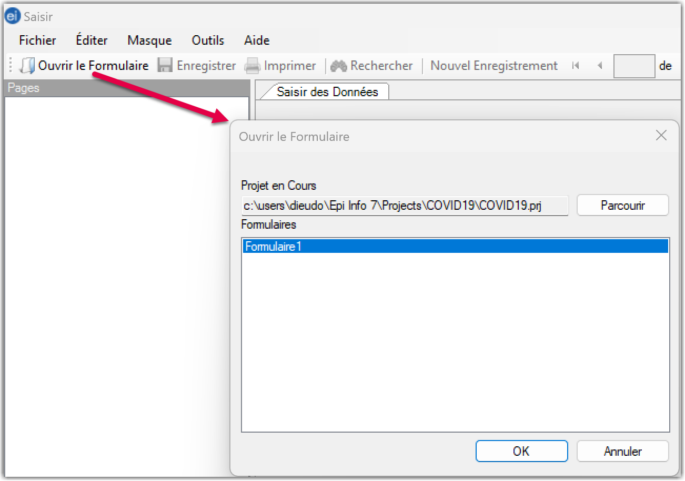

# Saisir des données {#sec-saisirDonnees}

Lorsque le questionnaire est prêt, et avant de commencer la collecte des vraies données, nous devons le tester pour nous assurer qu’il se comporte comme prévu. Cette étape ne doit pas être négligée : si vous commencez la collecte et découvrez plus tard un problème dans un champ, sa correction peut vous faire perdre les données déjà saisies.

## Ouvrir un formulaire pour la saisie

Pour saisir des données :

1.  Ouvrir le module **[saisir des données]{.smallcaps}** d’Epi Info 7 ;
2.  Cliquer sur **Ouvrir le Formulaire** dans la barre d’outils (ou dans le menu **Fichier**). La fenêtre **Ouvrir le Formulaire** s’ouvre (@fig-ouvrirformulaire) ;
3.  Dans **Projet en Cours**, cliquer sur **Parcourir** et sélectionner notre projet, le fichier `COVID19.prj` ;
4.  Dans la liste **Formulaires**, sélectionner `Formulaire1` et valider par **OK** ;
5.  À la première ouverture, une seconde fenêtre intitulée **Propriétés de la table de données** apparaît, avec le nom de la table de données, ici `Formulaire1`, et l’identifiant de départ, **1**. Cliquer sur **OK**.

{#fig-ouvrirformulaire}

::: {.callout-tip title="Conseil"}

Vous pouvez passer du module **[créer questionnaires]{.smallcaps}** au module **[saisir des données]{.smallcaps}** sans quitter l’un pour ouvrir l’autre : cliquez sur **Saisir des données** dans le premier, et sur **Éditer le formulaire** dans le second.

:::

## Saisir et enregistrer un enregistrement

Le formulaire s’affiche tel que nous l’avons conçu, avec un enregistrement vide. Pour le remplir :

1.  Saisir la réponse dans le premier champ, puis appuyer sur la touche **Tabulation** (ou **Entrée**) pour passer au champ suivant, dans l’ordre de tabulation défini au chapitre [-@sec-creerQuestionnaire] ;
2.  Observer au passage le comportement du code de contrôle : l’âge et l’IMC doivent se calculer seuls, une taille de 350 cm doit déclencher le message d’alerte, et les questions sur la non-vaccination ne doivent s’activer que si la personne n’est pas vaccinée ;
3.  Pour changer de page, utiliser la liste des pages dans le volet de gauche ;
4.  Une fois tous les champs remplis, cliquer sur **Nouvel enregistrement** pour passer à la fiche suivante.

Epi Info enregistre automatiquement la fiche lorsque l’on passe à un nouvel enregistrement, que l’on change d’enregistrement ou que l’on ferme le formulaire. Le bouton **Enregistrer** permet aussi de sauvegarder à tout moment. Si un champ requis est vide, Epi Info empêche l’enregistrement de la fiche et le signale.

## Naviguer et rechercher dans les enregistrements

La barre d’outils du module permet de se déplacer d’un enregistrement à l’autre : premier, précédent, suivant, dernier. On peut aussi taper directement le numéro de la fiche recherchée. Le bouton **Rechercher** permet de retrouver une fiche à partir de la valeur d’un ou de plusieurs champs, par exemple le nom de la personne enquêtée.

Pour supprimer une fiche saisie par erreur, l’afficher puis cliquer sur **Supprimer**. La fiche est alors marquée comme supprimée et n’est plus prise en compte dans les analyses ; le bouton **Restaurer** permet d’annuler cette suppression.

## Tester le questionnaire puis le réinitialiser

Pour le test, nous saisissons quelques fiches avec des données fictives, en essayant volontairement des valeurs erronées pour vérifier que les contrôles fonctionnent. Si le test est concluant, il faut réinitialiser le questionnaire afin de commencer la collecte avec une table vide. Pour cela, dans le module **[créer questionnaires]{.smallcaps}**, cliquer sur le menu **Outils** puis sur **Supprimer la table de données**. La procédure est la même si le test révèle des incohérences à corriger dans le questionnaire.

::: {.callout-important title="Important"}

Une fois des données saisies, certaines modifications du questionnaire (supprimer un champ, changer son type ou son nom) ne sont plus possibles ou font perdre les données correspondantes. Pour modifier en profondeur le questionnaire après le test, supprimez d’abord la table de données. Une fois la collecte commencée, évitez de modifier la structure du questionnaire.

:::
