# Module Tableau de bord visuel {#sec-moduleTableauDeBord}

Le **[tableau de bord visuel]{.smallcaps}** est l’un des deux modules d’analyse d’Epi Info 7. Il est conçu pour être intuitif et simple d’utilisation : grâce aux *gadgets*, il n’est presque pas nécessaire d’écrire du code. Les gadgets permettent de sélectionner, trier, lister ou transformer les données, de réaliser des statistiques simples (fréquences, moyennes, etc.) et des analyses plus avancées (des modèles de régression par exemple). Le module dispose aussi de fonctions graphiques pour visualiser les données. Nous pourrons également représenter nos résultats avec d’autres logiciels comme Microsoft Excel ou LibreOffice Calc, l’équivalent gratuit et multiplateforme d’Excel.

On accède au module à partir de la fenêtre d’accueil d’Epi Info 7, en cliquant sur le bouton **[tableau de bord visuel]{.smallcaps}** (@fig-tableaudebord).

{#fig-tableaudebord}

## Rappel : les types de variables {#sec-typesVariables}

Avant d’analyser des données, il faut connaître le type de chaque variable, car c’est lui qui détermine les statistiques possibles. On distingue deux grands groupes de variables : les variables *quantitatives* et les variables *qualitatives*.

### Variables quantitatives

Les modalités d’une variable quantitative sont des nombres qui expriment une quantité : additionner ou soustraire ces valeurs a un sens. On distingue :

-   **les variables quantitatives discrètes**, qui ne prennent que des valeurs isolées, le plus souvent entières, issues d’un comptage (exemple : le nombre d’enfants d’une femme, le nombre de consultations dans l’année) ;
-   **les variables quantitatives continues**, qui peuvent prendre n’importe quelle valeur dans un intervalle, issues d’une mesure (exemple : la taille, le poids ou la pression artérielle d’un individu).

### Variables qualitatives

Les modalités d’une variable qualitative ne sont pas des quantités numériques : on ne peut pas en faire la somme ou la différence. Le groupe sanguin du système ABO, avec ses modalités A, B, AB et O, en est un exemple. Une variable qualitative peut être :

-   **binaire** : elle n’a que deux modalités. Exemples : le sexe (masculin/féminin), être au chômage (oui/non), être majeur (oui/non). Les variables binaires sont très utilisées, notamment en épidémiologie (malade/non malade, exposé/non exposé) ;
-   **ordinale** : ses modalités sont ordonnées. Exemple : le niveau de satisfaction vis-à-vis d’un service de santé, avec les modalités « pas du tout satisfait », « peu satisfait », « moyennement satisfait » et « très satisfait », que l’on peut coder 0, 1, 2 et 3 ;
-   **nominale** : elle a trois modalités ou plus, sans ordre entre elles. Exemples : la couleur des yeux, la profession, le groupe sanguin.

## Ouvrir le module et importer des données

Comme de nombreux logiciels d’analyse statistique ([r]{.smallcaps}, [stata]{.smallcaps}, [spss]{.smallcaps}…), Epi Info 7 est fourni avec des bases de données d’exemple pour apprendre les statistiques. Pour que chacun puisse refaire les manipulations, nous utiliserons dans ce chapitre la base `EColi`, qui décrit une épidémie d’infection à *Escherichia coli* liée à l’alimentation.

Lorsque nous ouvrons le module **[tableau de bord visuel]{.smallcaps}**, son interface présente trois parties principales : l’**en-tête**, le **canevas** et la **barre d’état** (@fig-interfacetableaubord).

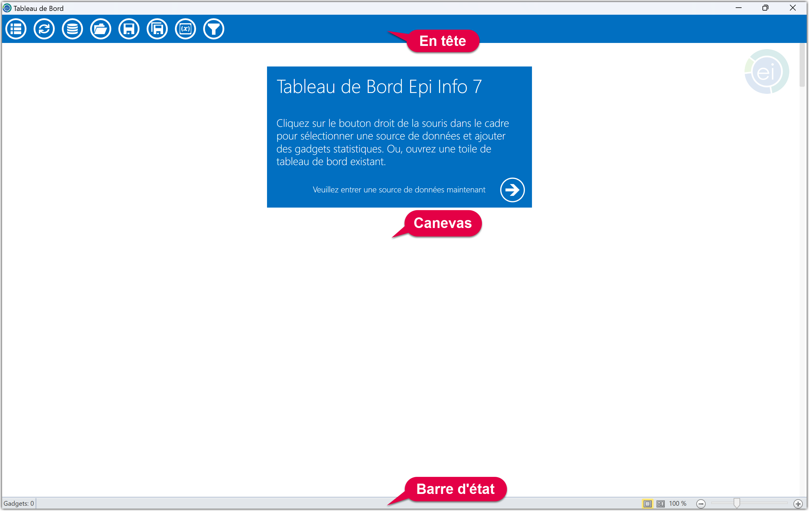{#fig-interfacetableaubord}

Pour importer les données d’une base Epi Info 7, procéder comme suit (@fig-importerbaseepi) :

-   Cliquer sur **Veuillez entrer une source de données maintenant** dans le canevas, ou sur le symbole de base de données dans l’en-tête ;
-   Cliquer sur le bouton **Parcourir**. Une fenêtre s’ouvre sur le dossier `Projects` d’Epi Info, qui contient toutes les bases fournies avec le logiciel ;
-   Choisir la base de données `EColi` ;
-   La base comporte deux formulaires : `FoodHistory` et `FoodHistory_NoCheckCode`. Sélectionner le premier, `FoodHistory` ;
-   Valider par **OK**.

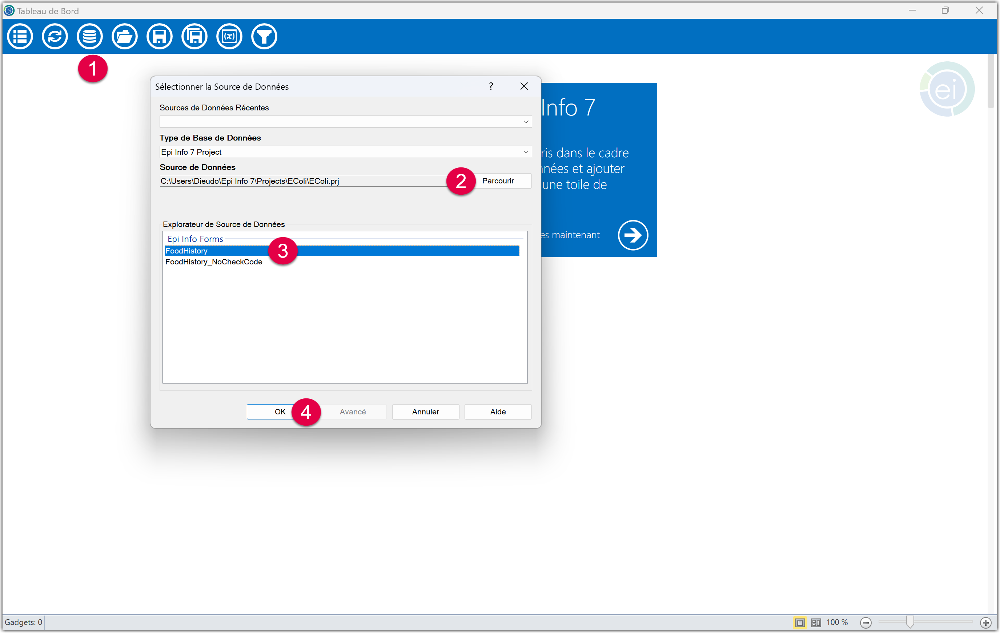{#fig-importerbaseepi}

Après l’import, le nombre d’enregistrements de la base s’affiche en haut à droite : 359 enregistrements. Ce nombre apparaît aussi dans la barre d’état, avec le nombre de champs, 83. Deux volets apparaissent sur les bords gauche et droit du canevas ; ils se déplient au survol de la souris. Le volet de gauche, **Variables définies**, permet de créer et de recoder des variables ; celui de droite, **Filtres de données**, permet de travailler sur un sous-groupe de données (@fig-interfaceapresimportdonnees).

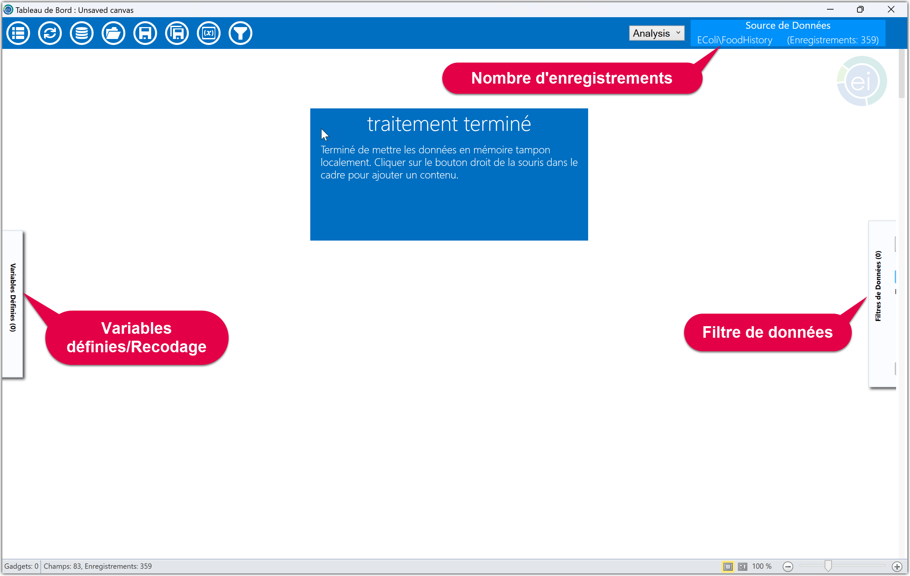{#fig-interfaceapresimportdonnees}

## Statistiques descriptives

Passons maintenant à l’analyse statistique proprement dite, en commençant par la statistique descriptive. Nous utiliserons pour cela les gadgets d’analyse.

Pour ajouter un gadget, faire un clic droit sur le canevas puis aller à **Ajouter un gadget d’analyse**, repéré par une roue dentée. Au survol de cette ligne, un sous-menu apparaît avec les différents gadgets : moyennes, fréquences, etc. (@fig-TBajoutergadget).

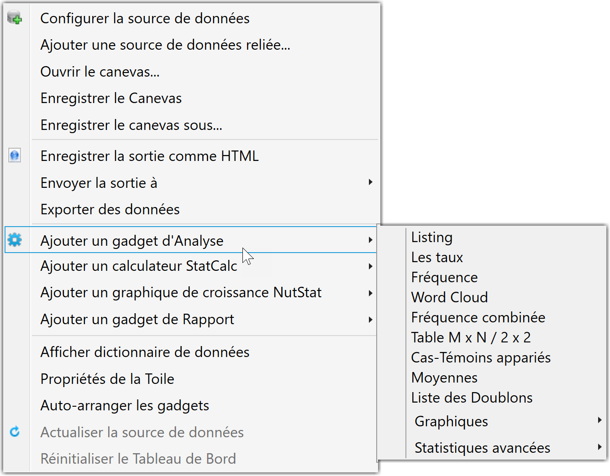{#fig-TBajoutergadget}

Le gadget **Listing** affiche les données brutes des variables choisies. Il permet de jeter un premier coup d’œil aux données et d’exporter les variables sélectionnées au format Excel.

### Calculer une fréquence

Le tableau de fréquences est l’outil de base pour décrire une variable qualitative : il donne, pour chaque modalité, l’effectif et le pourcentage. Pour l’obtenir :

-   Faire un clic droit sur le canevas ;
-   Aller à **Ajouter un gadget d’analyse** ;
-   Cliquer sur **Fréquence** dans le sous-menu ;
-   Dans le champ **Variables**, choisir la variable à décrire, ici `ILL` (« malade » en anglais) ;
-   Valider par **OK** (@fig-frequence).

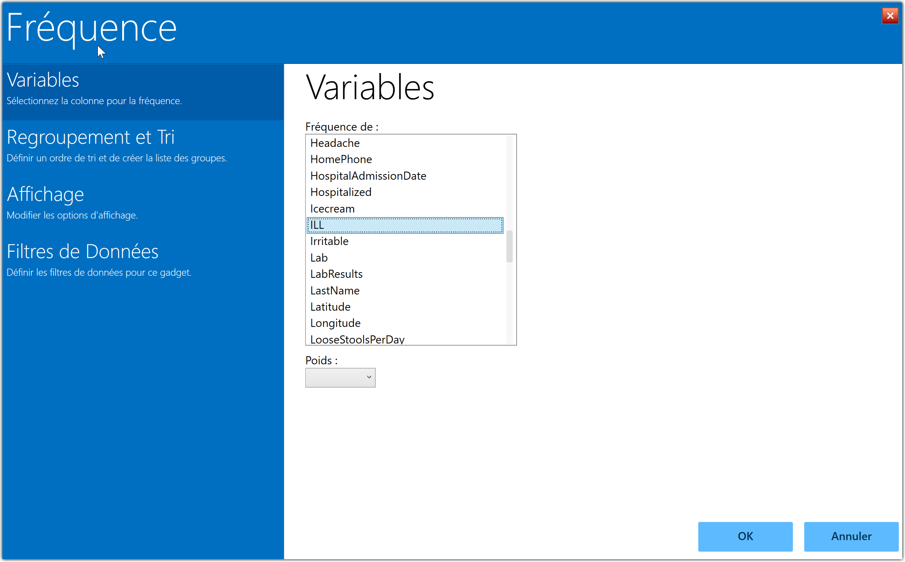{#fig-frequence}

Le gadget de fréquence de la variable `ILL` s’affiche alors (@fig-frequenceill). Sur 359 personnes enquêtées, 276 étaient malades (**Yes**) et 83 ne l’étaient pas (**No**), soit respectivement 76,88 % et 23,12 %. Les deux dernières colonnes donnent l’intervalle de confiance à 95 % de chaque pourcentage, calculé par la méthode de Wilson : par exemple, la proportion de malades est comprise entre 72,25 % et 80,94 %.

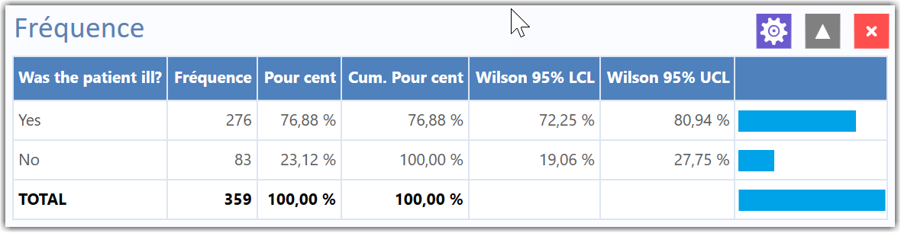{#fig-frequenceill}

Nous pouvons stratifier une fréquence selon une autre variable pour obtenir des informations supplémentaires. Cherchons par exemple la proportion de malades selon le sexe. La variable du sexe s’appelle ici `Sex` ; deux de ses modalités contiennent des données : **M-Male** (sexe masculin) et **F-Female** (sexe féminin)[^05-1]. Pour cela :

-   Rouvrir les paramètres du gadget de fréquence, soit comme précédemment, soit plus simplement en cliquant sur la roue dentée en haut à droite du gadget (@fig-frequenceill) ;
-   Dans le volet bleu à gauche, aller dans l’onglet **Regroupement et tri** et sélectionner la variable `Sex` ;
-   Valider par **OK**.

Nous obtenons deux tableaux (@fig-frequenceillsex). Le tableau du haut concerne les femmes, celui du bas les hommes. Sur 186 femmes, 147 (79,03 %) sont malades et 39 (20,97 %) ne le sont pas. Sur 173 hommes, 129 (74,57 %) sont malades et 44 (25,43 %) ne le sont pas.

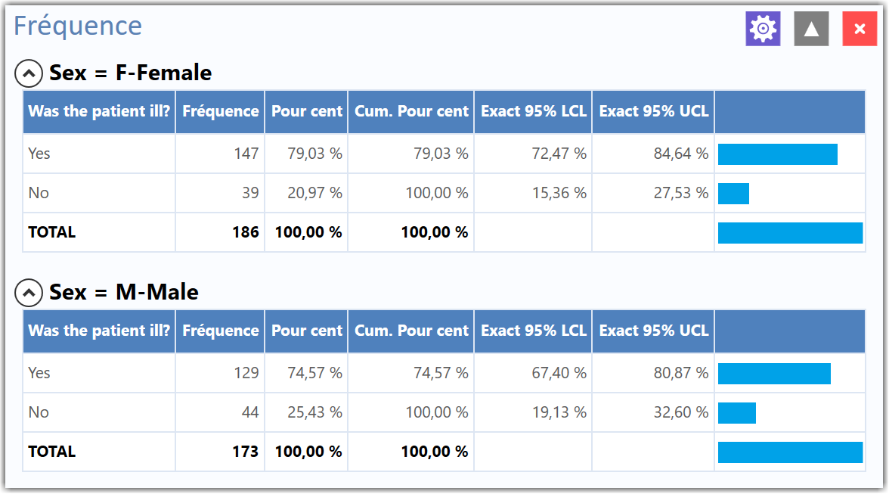{#fig-frequenceillsex}

## Paramètres de position

Les paramètres de position, ou de tendance centrale, donnent l’ordre de grandeur des mesures : ce sont les valeurs autour desquelles se regroupent les observations de l’échantillon. Ils s’appliquent aux variables quantitatives.

### La moyenne {#sec-moyenne}

La valeur centrale la plus utilisée est la moyenne arithmétique, notée $\bar{x}$ : c’est la somme des mesures divisée par le nombre de mesures $n$. $$\bar{x}=\frac{1}{n} \sum_{i=1}^n x_i$$

Exemple : soit la taille, en centimètres, de cinq individus : 170, 191, 175, 154 et 182. En appliquant la formule, la taille moyenne est $(170+191+175+154+182)/5 = 872/5 = 174{,}4$ cm.

La moyenne est facile à calculer, mais elle est sensible aux valeurs extrêmes et aux erreurs de saisie : une seule valeur aberrante peut la déplacer fortement.

Calculons maintenant l’âge moyen des personnes de la base EColi :

-   Faire un clic droit sur le canevas ;
-   Aller à **Ajouter un gadget d’analyse** ;
-   Cliquer sur **Moyennes** ;
-   Vérifier que vous êtes dans l’onglet consacré aux variables ;
-   Sélectionner la variable `Age` ;
-   Valider par **OK**.

Nous obtenons le résultat de la @fig-moyenne.

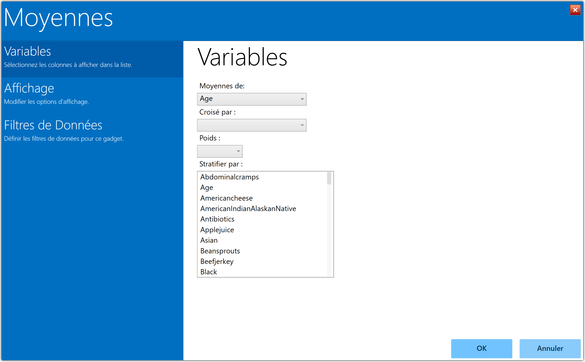{#fig-moyenne}

Comme pour la fréquence, nous pouvons croiser la moyenne avec une autre variable. Associons à la variable âge la variable sexe pour connaître l’âge moyen des femmes et celui des hommes :

-   Rouvrir les paramètres du gadget des moyennes, par exemple en cliquant sur la roue dentée en haut à droite du gadget (@fig-moyenne) ;
-   Rester dans l’onglet consacré aux variables et, dans le champ **Croisé par**, sélectionner la variable `Sex` ;
-   Valider par **OK**.

Les résultats s’affichent comme sur la @fig-moyenneresultatage. Pour l’ensemble de l’échantillon, ils se lisent ainsi :

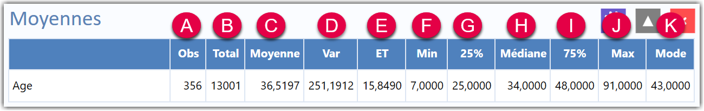{#fig-moyenneresultatage}

-   **(A)** **Obs** : le nombre d’observations, égal à 356 ;
-   **(B)** **Total** : la somme des âges, égale à 13 001 ;
-   **(C)** **Moyenne** : la *moyenne* des âges, égale au rapport $B/A$, soit $13\,001/356 = 36{,}52$ ans ;
-   **(D)** **Var** : la *variance*, égale à 251,19 ;
-   **(E)** **ET** : l’*écart-type*, égal à 15,85 ans ;
-   **(F)** **Min** : le *minimum*, 7 ans ;
-   **(G)** **25 %** : le *premier quartile*, 25 ans ;
-   **(H)** **Médiane** : la *médiane*, 34 ans ;
-   **(I)** **75 %** : le *troisième quartile*, 48 ans ;
-   **(J)** **Max** : le *maximum*, 91 ans ;
-   **(K)** **Mode** : le *mode*, c’est-à-dire l’âge le plus fréquent, 43 ans.

Pas d’inquiétude si certains termes vous sont encore inconnus : nous les expliquons dans les sections suivantes.

### La médiane

La médiane est la valeur qui partage la série en deux groupes de même effectif : autant d’observations lui sont inférieures que supérieures. Elle s’exprime dans la même unité que les valeurs observées. Pour déterminer la médiane d’une série, il faut d’abord l’ordonner. Reprenons l’exemple des cinq tailles. Une fois ordonnée, la série devient : 154, 170, 175, 182, 191. La médiane est la valeur du milieu, soit 175 cm. Lorsque l’effectif est pair, la médiane est la moyenne des deux valeurs du milieu.

Contrairement à la moyenne, la médiane est peu sensible aux valeurs extrêmes. On la préfère donc pour décrire une variable dont la distribution est asymétrique.

### Le mode

Le mode, ou valeur dominante, est la valeur de la variable dont la fréquence est la plus élevée. Lorsque les données sont regroupées en classes, on parle de classe modale : c’est la classe dont la fréquence est maximale. Dans le cas d’une courbe continue des fréquences, c’est l’abscisse du point le plus haut de la courbe. Lorsque la distribution est symétrique et unimodale, la moyenne, la médiane et le mode sont confondus.

### Les quantiles

Les quantiles sont les valeurs qui partagent l’échantillon ordonné en groupes de même effectif. Ils portent des noms différents selon le nombre de groupes : quartiles pour quatre groupes, déciles pour dix groupes, centiles pour cent groupes.

Pour partager la série en quatre groupes de même effectif, il faut trois valeurs, appelées quartiles : $Q_1$, $Q_2$ et $Q_3$. Un quart des observations se trouve entre le minimum et $Q_1$, un quart entre $Q_1$ et $Q_2$, un quart entre $Q_2$ et $Q_3$, et le dernier quart entre $Q_3$ et le maximum. Comme nous le verrons dans la section sur les paramètres de dispersion, les quartiles servent aussi à définir des intervalles.

::: {.callout-note title="À retenir"}

Le deuxième quartile, $Q_2$, n’est autre que la médiane.

:::

## Paramètres de dispersion

Deux séries peuvent avoir la même moyenne tout en étant très différentes : l’une très resserrée autour de la moyenne, l’autre très étalée. Les paramètres de dispersion mesurent cet étalement.

### Variance et écart-type

La variance est la moyenne des carrés des écarts à la moyenne de l’échantillon : $$\operatorname{Var}(X)=\frac{1}{n}\sum_{i=1}^n \left(x_i-\bar{x}\right)^2$$ où $\bar{x}$ est la moyenne de la série et $n$ l’effectif.

::: {.callout-warning title="Avertissement"}

$\operatorname{Var}(X)$ est la variance de l’échantillon : ce n’est ni la variance de la population dont l’échantillon est issu, ni une estimation de celle-ci. Pour estimer la variance de la population, on divise par $n-1$ au lieu de $n$. C’est cette variance estimée que calculent la plupart des logiciels, dont Epi Info.

:::

La variance s’exprime dans le carré de l’unité de mesure (en années$^2$ pour l’âge), ce qui la rend difficile à interpréter. Pour disposer d’un indice de dispersion exprimé dans la même unité que la variable, on utilise sa racine carrée, l’écart-type : $$\text{Écart-type}(X)=\sqrt{\operatorname{Var}(X)}$$ Dans la base EColi, l’écart-type de l’âge est de 15,85 ans, soit la racine carrée de la variance, 251,19.

### Autres paramètres de dispersion

L’*étendue* $e$ d’une série est la différence entre sa plus grande et sa plus petite valeur : $e=x_{\max}-x_{\min}$. Pour l’âge dans la base EColi, l’étendue est de $91-7=84$ ans.

L’*intervalle interquartile* contient les 50 % d’observations centrales de la série. Ses bornes sont $Q_1$ et $Q_3$. Sa largeur, $I = Q_3 - Q_1$, renseigne sur la dispersion des données : plus elle est faible, plus les données sont groupées autour de la médiane. Pour l’âge, l’intervalle interquartile va de 25 à 48 ans : sa largeur est de $48-25=23$ ans.

## Tableau 2x2 et mesures d'association {#sec-tableau2x2}

Jusqu’ici, nous avons décrit les variables une par une. Nous allons maintenant étudier le lien entre deux variables qualitatives, et aborder ainsi les tests statistiques, ou statistique inférentielle.

### Principe des tests statistiques

Un test statistique suit toujours la même démarche :

1.  **Formuler deux hypothèses** : l’hypothèse nulle $H_0$ (par exemple, il n’y a pas d’association entre l’exposition et la maladie) et l’hypothèse alternative $H_1$ (il existe une association) ;
2.  **Prédire** ce que l’on devrait observer si $H_0$ était vraie : par exemple, la même proportion de malades chez les exposés et chez les non-exposés ;
3.  **Observer** les données réellement recueillies ;
4.  **Confronter** les observations à la prédiction. Le test calcule la probabilité, appelée *valeur *p**, d’observer un écart au moins aussi grand que celui constaté si $H_0$ était vraie ;
5.  **Conclure** : si la valeur *p* est inférieure au seuil choisi à l’avance, généralement 5 % ($p < 0{,}05$), on rejette $H_0$ et on conclut à une association statistiquement significative. Sinon, on ne peut pas rejeter $H_0$ ;
6.  **Garder en tête les risques d’erreur** : le risque $\alpha$ de conclure à tort à une association (en général fixé à 5 %) et le risque $\beta$ de passer à côté d’une association qui existe réellement.

### Risque relatif et odds ratio

Dans de nombreuses disciplines, on cherche à quantifier la force de la liaison entre deux variables binaires. En médecine, le cas le plus fréquent est l’association entre une maladie et un facteur de risque, par exemple le fait d’être un gros fumeur et de développer plus tard un infarctus du myocarde.

Les données se présentent alors sous la forme d’un tableau 2x2 classique, avec en colonnes les malades et les non-malades, et en lignes les sujets qui présentent le facteur de risque (FR) et ceux qui ne le présentent pas (@tbl-2x2).

|              | Maladie : oui | Maladie : non | Total   |
|:-------------|:-------------:|:-------------:|:-------:|
| **FR = oui** | $a$           | $b$           | $a+b$   |
| **FR = non** | $c$           | $d$           | $c+d$   |

: Tableau de contingence 2x2 {#tbl-2x2}

Le paramètre le plus intuitif pour mesurer la force de l’association est le *risque relatif* (RR). C’est la proportion de malades parmi les sujets exposés au facteur de risque, divisée par la proportion de malades parmi les sujets non exposés : $$\text{RR}=\frac{a/(a+b)}{c/(c+d)}$$ On dit par exemple que le risque relatif de cancer du poumon associé à une forte consommation de tabac est d’environ 10 : par rapport à un non-fumeur, un gros fumeur a dix fois plus de risque de développer un cancer du poumon. C’est un paramètre clair, simple et facile à interpréter.

Le risque relatif n’est pas le seul paramètre utilisable : il existe aussi l’*odds ratio* (OR), parfois traduit par « rapport des cotes », la cote au sens du turfiste qui parie à trois contre un sur un cheval. L’odds ratio est le rapport malades/non-malades chez les sujets exposés, divisé par le même rapport chez les sujets non exposés : $$\text{OR}=\frac{a/b}{c/d}=\frac{a \times d}{b \times c}$$

Pour ces deux mesures, une valeur égale à 1 signifie l’absence d’association, une valeur supérieure à 1 une association positive (facteur de risque) et une valeur inférieure à 1 une association négative (facteur protecteur).

#### Avantages de l'odds ratio {.unnumbered .unlisted}

-   L’odds ratio peut être estimé aussi bien dans une enquête cas-témoins que dans une enquête de cohorte ou une enquête en population générale. Le risque relatif, lui, ne peut être calculé que dans une cohorte ou une enquête en population générale : dans une enquête cas-témoins (par exemple 300 patients ayant eu un infarctus comparés à 300 sujets sains), c’est l’enquêteur qui fixe la proportion de malades, et le RR n’a donc pas de sens ;
-   Il permet de prendre en compte les facteurs de confusion. Imaginons que l’on observe une association statistiquement significative entre obésité et infarctus du myocarde. Il est possible que ce ne soit pas l’obésité elle-même qui soit en cause : l’obésité est peut-être associée à une faible activité physique, et c’est ce manque d’activité qui augmenterait le risque d’infarctus. Pour démêler ces effets, on utilise un modèle statistique, la régression logistique, qui estime le poids propre de chaque facteur. Or ce modèle estime des odds ratios ajustés, et beaucoup plus difficilement des risques relatifs ajustés ;
-   Lorsque la maladie est rare, l’odds ratio est très proche du risque relatif.

### Réaliser un tableau 2x2 dans le Tableau de bord

Nous allons rechercher s’il existe une association entre le fait d’avoir mangé de la crème glacée et le fait d’être tombé malade lors de l’épidémie à *E. coli*. La base EColi est en effet un questionnaire sur les aliments consommés lors d’un repas suspect : pour chaque aliment, une variable Oui/Non indique si la personne en a mangé (@fig-foodeaten).

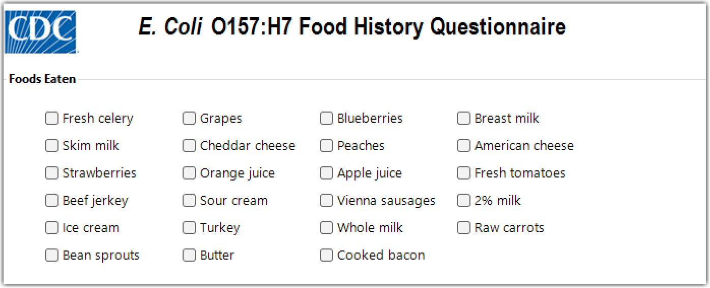{#fig-foodeaten}

Le gadget **Table MxN / 2x2** sert à croiser deux variables qualitatives. Pour l’utiliser :

1.  Faire un clic droit sur le canevas, aller à **Ajouter un gadget d’analyse** et choisir **Table MxN / 2x2**. La fenêtre du gadget apparaît (@fig-tabulationcroise) ;
2.  Dans le champ **Exposition**, choisir la variable de l’exposition, ici `Icecream` ;
3.  Dans le champ **Variable à de résultats** (libellé tel qu’il apparaît dans Epi Info), choisir la variable du résultat, ici `ILL`. Le champ **Stratifier par** permet de stratifier l’analyse selon une troisième variable ;
4.  Valider par **OK** (@fig-tabulationcroiseicecreamill).

{#fig-tabulationcroise}

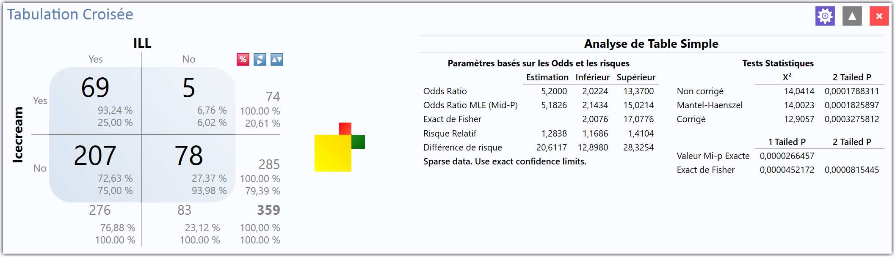{#fig-tabulationcroiseicecreamill}

Pour que les mesures d’association aient leur sens épidémiologique habituel, la présence de l’exposition et la présence de la maladie doivent apparaître sur la première ligne et dans la première colonne du tableau. C’est le cas pour les variables Oui/Non d’Epi Info, qui sont triées automatiquement avec **Yes** en premier. Les valeurs de la variable d’exposition s’affichent en lignes et celles de la variable de résultat en colonnes.

Pour un tableau 2x2, le gadget affiche :

-   le tableau croisé avec les effectifs et les pourcentages en ligne et en colonne ;
-   l’*odds ratio* et le *risque relatif*, chacun avec son intervalle de confiance à 95 % ;
-   les tests statistiques : chi carré (non corrigé, de Mantel-Haenszel et corrigé de Yates) et, pour les petits effectifs, le test exact de Fisher, avec leurs valeurs *p*.

Pour un tableau de plus de deux lignes ou deux colonnes (MxN), seul le chi carré est calculé.

L’interprétation se fait en deux temps. On lit d’abord la mesure d’association : un OR ou un RR supérieur à 1 suggère que la crème glacée est un facteur de risque. On vérifie ensuite si l’association est statistiquement significative : c’est le cas si la valeur *p* est inférieure à 0,05, ou, ce qui revient au même, si l’intervalle de confiance à 95 % ne contient pas la valeur 1.

Appliquons cette lecture à nos résultats (@fig-tabulationcroiseicecreamill). Parmi les 74 personnes qui ont mangé de la crème glacée, 69 sont tombées malades, soit 93,24 % ; parmi les 285 qui n’en ont pas mangé, 207 sont tombées malades, soit 72,63 %. Le risque relatif vaut $0{,}9324/0{,}7263 = 1{,}28$ (IC à 95 % : 1,17 à 1,41) : les consommateurs de crème glacée ont eu un risque de maladie 1,28 fois plus élevé que les autres. L’odds ratio vaut $(69 \times 78)/(5 \times 207) = 5{,}20$ (IC à 95 % : 2,02 à 13,37). Le chi carré non corrigé vaut 14,04, avec une valeur *p* de 0,0002. Les deux intervalles de confiance excluent 1 et la valeur *p* est très inférieure à 0,05 : l’association entre la consommation de crème glacée et la maladie est statistiquement significative.

Remarquez l’écart entre l’OR (5,20) et le RR (1,28) : la maladie étant ici très fréquente (76,88 % de malades), l’odds ratio surestime fortement le risque relatif. Dans une enquête de cohorte comme celle-ci, c’est le risque relatif qu’il faut privilégier.

::: {.callout-warning title="Avertissement"}

Une association statistiquement significative ne prouve pas un lien de causalité. Elle peut être due à un biais ou à un facteur de confusion. La conclusion doit toujours tenir compte du type d’enquête et des autres éléments disponibles.

:::

::: {.callout-tip title="Conseil"}

Pour obtenir en une seule fois l’association entre la maladie et chacun des aliments répertoriés dans la base, sélectionnez dans le champ **Exposition** la variable `FoodsEaten` au lieu de `Icecream`. `FoodsEaten` est le nom du groupe qui rassemble les aliments consommés (question **Foods Eaten**) : le gadget calcule alors un tableau 2x2 pour chaque aliment.

:::

## Recodage de variables {#sec-recodage}

Si l’on représente graphiquement la variable âge telle quelle, chaque valeur d’âge présente dans la base apparaît séparément, ce qui rend le graphique illisible. Il faut alors recoder l’âge en tranches d’âge.

Pour cela :

-   Survoler avec la souris le bord gauche du canevas, où se trouve un petit rectangle portant la mention **Variables définies**. Le volet se déplie ; on peut lire en bas, de gauche à droite, **Nouvelle variable**, **Éditer variable** et **Supprimer variable** ;
-   Cliquer sur le premier bouton. Un sous-menu apparaît : cliquer sur **Avec valeur transcodée** (@fig-recodervariable) ;
-   Une fenêtre d’édition s’ouvre :
    1.  Dans **Champ de source**, sélectionner la variable `Age` ;
    2.  Dans **Champ de destination**, indiquer le nom de la nouvelle variable. Epi Info propose par défaut le nom de la variable d’origine suivi d’un tiret bas et du mot `RECODED`, ici `Age_RECODED`. Vous pouvez le modifier ;
    3.  Dans le champ **Type du champ de destination**, choisir entre **Text**, **Numeric** et **Yes/No**. Nous gardons le type **Text**, car nous ne ferons pas de calculs sur la nouvelle variable ;
    4.  Laisser cochée la case **Maintient l’ordre de classement le cas échéant** ;
    5.  Cliquer en bas de la fenêtre sur **Saisir les valeurs de l’intervalle**. Rappelons que l’âge varie de 7 à 91 ans. Par défaut, Epi Info encadre les intervalles par les valeurs extrêmes (**`LOVALUE`** pour le minimum et **`HIVALUE`** pour le maximum). Dans la fenêtre **Saisir les valeurs de l’intervalle**, nous saisissons la **Valeur de début**, ici 5, la **Valeur de fin**, ici 85, et dans la case **Par** l’amplitude des tranches, ici 10 ans ;
    6.  Valider par **OK**, puis de nouveau par **OK** (@fig-variableagerecoded et @fig-resultatrecodageage). Sur la @fig-resultatrecodageage, remarquez les valeurs **`LOVALUE`** et **`HIVALUE`**, qui représentent les valeurs extrêmes. De retour sur le canevas, la nouvelle variable figure dans le volet **Variables définies**, où l’on peut la modifier.

::: {.callout-warning title="Avertissement"}

Si vous quittez le Tableau de bord sans l’avoir sauvegardé, vous perdrez les variables que vous avez créées. Nous verrons à la section [-@sec-sauvegarderTableauDeBord], *Sauvegarder son espace de travail*, comment sauvegarder l’espace de travail.

:::

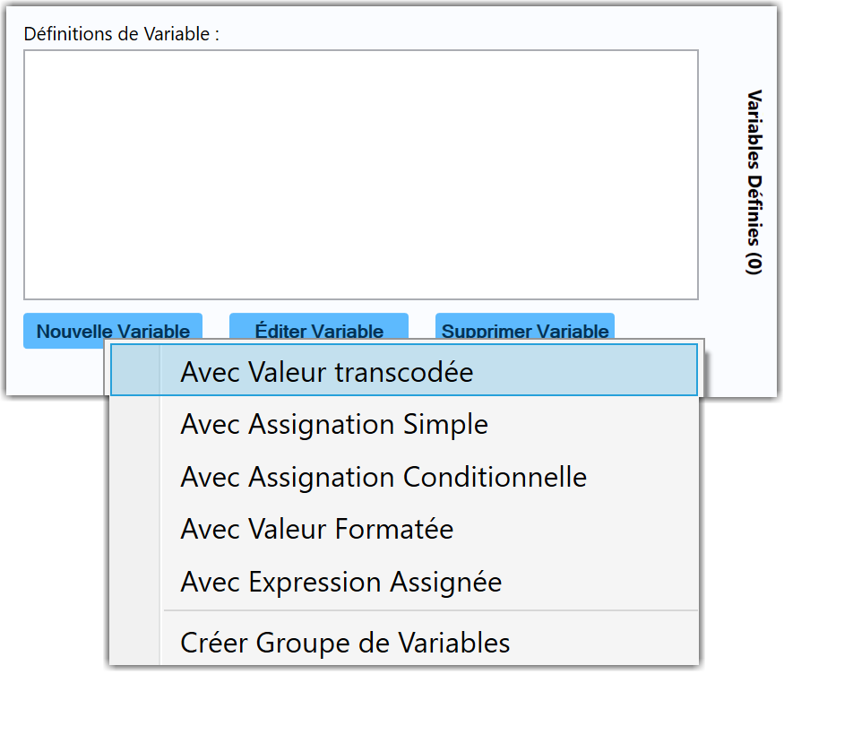{#fig-recodervariable}

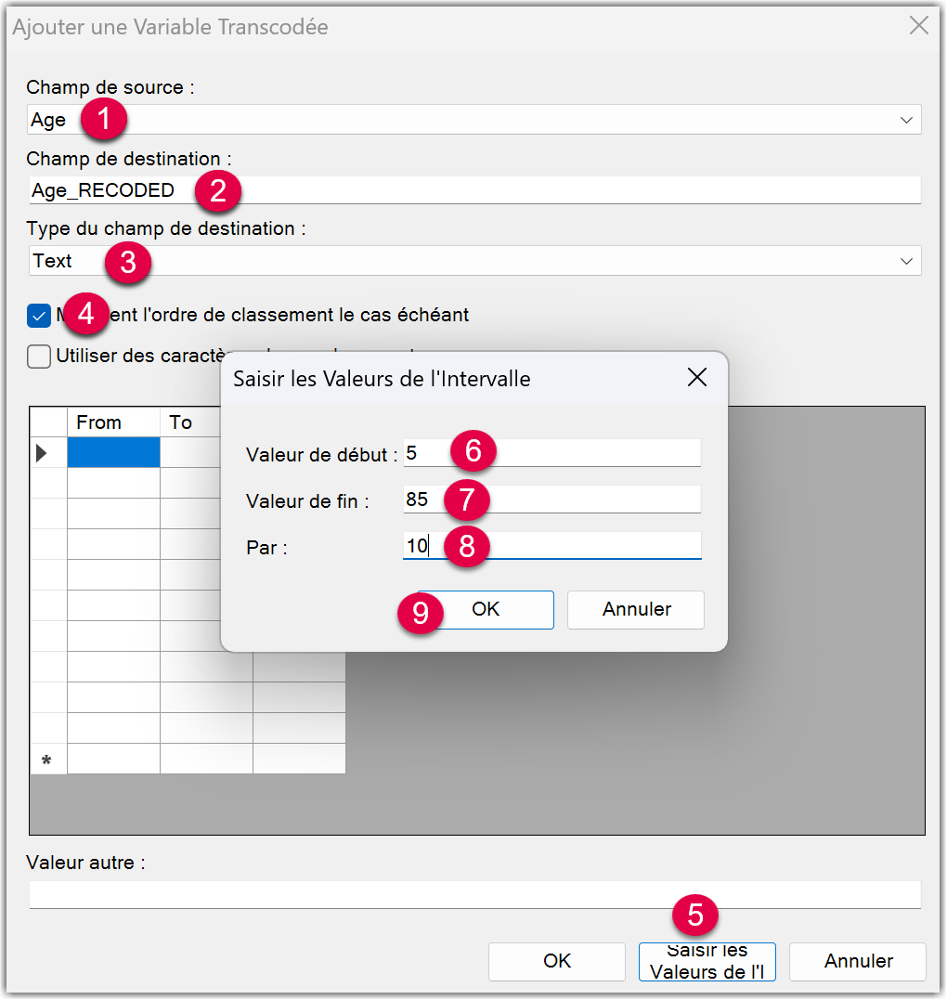{#fig-variableagerecoded}

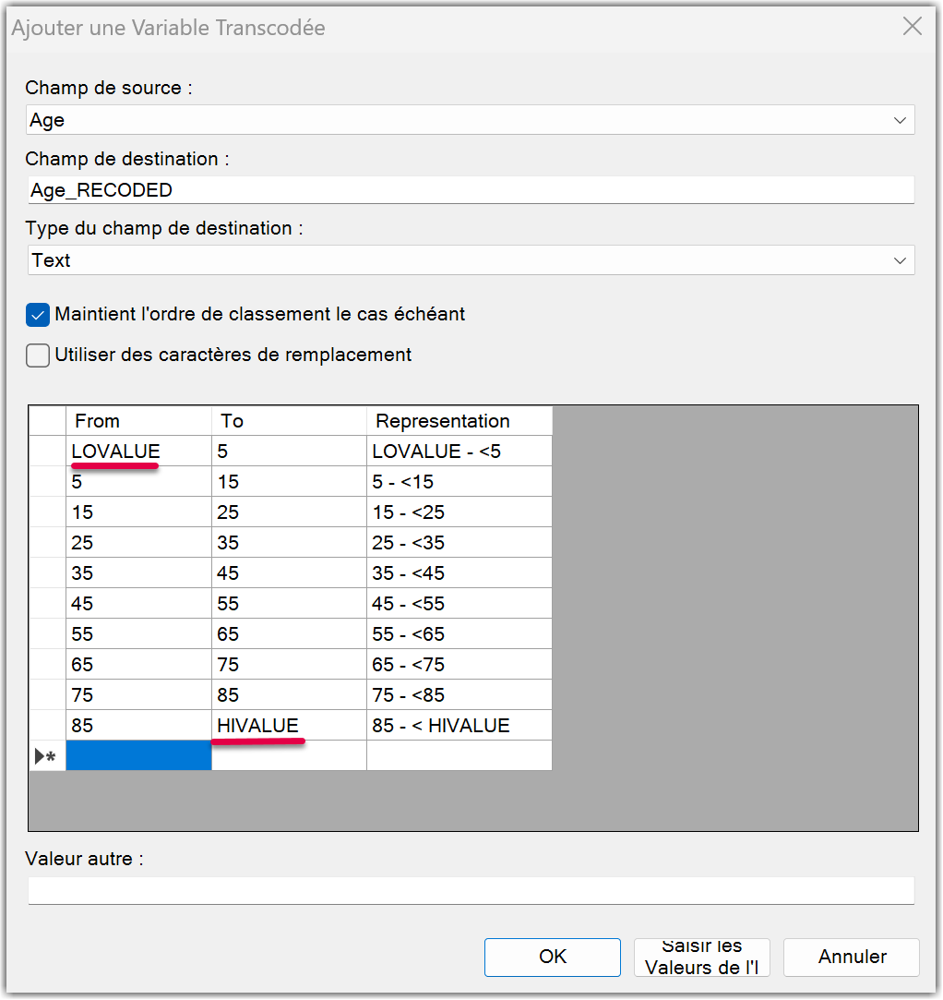{#fig-resultatrecodageage}

## Utiliser des filtres de données

Les filtres permettent de restreindre l’analyse à une partie des données. Cherchons par exemple le nombre d’**hommes malades âgés de 25 à 35 ans** :

-   Survoler avec la souris la petite zone rectangulaire située sur le bord droit du canevas. Le volet **Filtres de données** se déplie :
    1.  Dans la partie **Nom de champ**, sélectionner la variable `ILL` ;
    2.  Dans la partie **Opérateur**, choisir l’opérateur souhaité, ici **est égal à** ;
    3.  Choisir enfin la valeur, ici **Yes**. Très facile, n’est-ce pas ?
    4.  Cliquer sur **Ajouter un filtre**. Le filtre « La valeur de \[ILL\] est égal à Yes » apparaît dans la case **Filter criteria** de la partie **Filtres de données**. Pour ajouter un deuxième filtre, on recommence la procédure ;
    5.  Sélectionner cette fois la variable `Sex` ;
    6.  Choisir **est égal à** dans la partie **Opérateur** ;
    7.  Dans la partie valeur, toutes les modalités de la variable `Sex` s’affichent ; sélectionner **M-Male** ;
    8.  Cliquer sur **Ajouter un filtre** puis, dans le menu qui apparaît, sur **Ajouter avec ET** (on pourrait aussi choisir **Ajouter avec OU**). Le deuxième filtre, « La valeur de \[Sex\] est égal à M-Male », s’ajoute avec l’opérateur logique **and** ;
    9.  Ajouter le dernier filtre de la même manière, mais en choisissant la variable `Age` et l’opérateur **entre** ;
    10. Saisir les bornes de l’âge, 25 et 35, puis cliquer sur **Ajouter avec ET**. Le troisième filtre, « La valeur de Age est comprise entre 25 et 35 », s’ajoute avec l’opérateur logique **and** dans la colonne **Join** (@fig-filtre, @fig-filtreajouteret et @fig-filtreresultat).

Le filtre fonctionne : 39 enregistrements sont désormais visibles en haut à droite. Les filtres permettent de travailler sur une partie des données définie à l’avance. Attention : un filtre s’applique à tous les gadgets du canevas, y compris ceux créés avant lui, dont les résultats sont recalculés. Une note apparaît aussi sur le canevas : « Les filtres de toile suivants sont en vigueur : la valeur de \[ILL\] est égal à Yes and La valeur de \[Sex\] est égal à M-Male and La valeur de Age est comprise entre 25 et 35 ».

::: {.callout-warning title="Avertissement"}

Lorsque vous appliquez des filtres, vérifiez toujours sur quelle partie des données vous travaillez, en contrôlant régulièrement le nombre d’enregistrements affiché.

:::

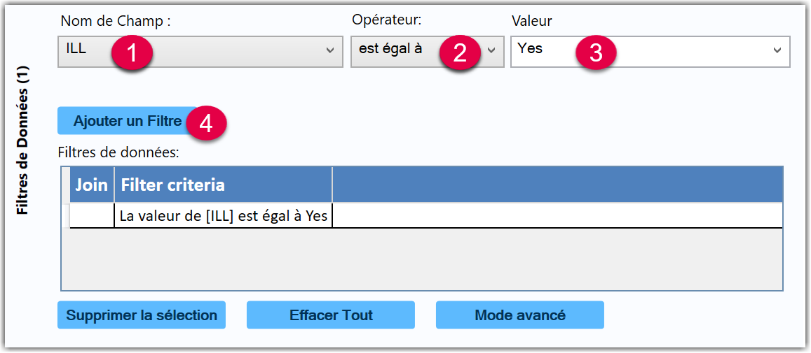{#fig-filtre}

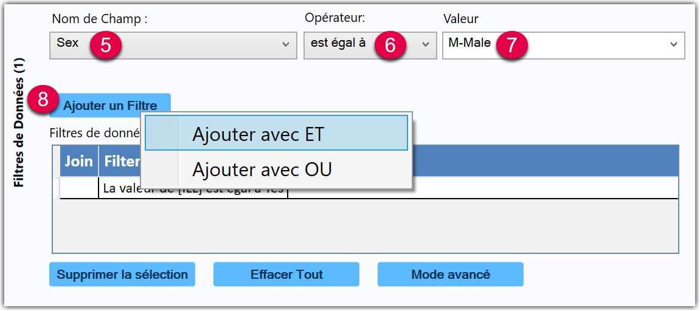{#fig-filtreajouteret}

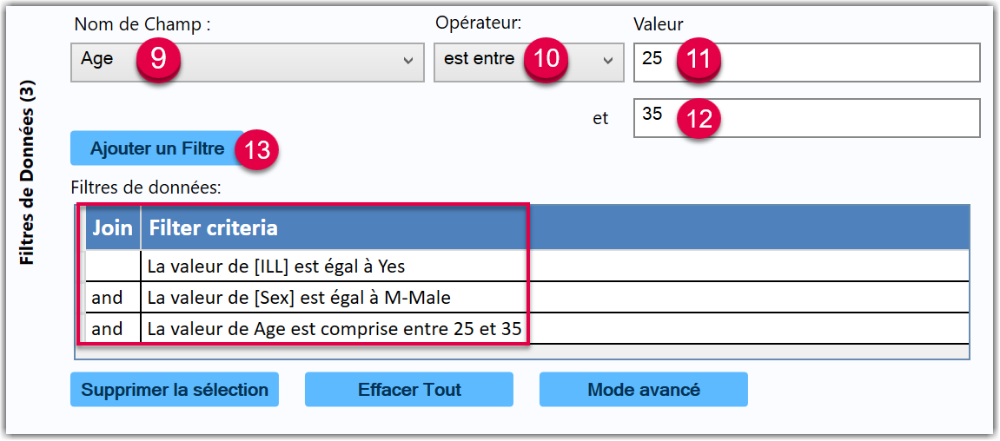{#fig-filtreresultat}

## Représentations graphiques

Il est possible, et très facile, de réaliser des graphiques dans Epi Info 7 : diagrammes en barres, histogrammes, diagrammes en secteurs (camemberts), etc. De façon générale, on procède comme suit :

1.  Faire un clic droit sur le canevas ;
2.  Sélectionner **Ajouter un gadget d’analyse** ;
3.  Sélectionner **Graphiques** ;
4.  Choisir le type de graphique : **Colonne** pour un diagramme en barres, **Secteur** pour un camembert, etc. ;
5.  La fenêtre de paramétrage du graphique s’ouvre.

### Exemple : la distribution des tranches d'âge

Représentons graphiquement la variable `Age_RECODED` créée à la section [-@sec-recodage]. Les tranches d’âge étant des classes d’une variable quantitative, nous utilisons un graphique en colonnes jointives, à la manière d’un histogramme. Nous procédons comme indiqué ci-dessus en sélectionnant **Graphique de la colonne** (@fig-representationhistogramme). Une fenêtre s’ouvre pour paramétrer le graphique (@fig-customisationhistogramme). Voici comment obtenir le graphique de la @fig-resultathistogramme :

-   **(A)** **Variables** : choisir la variable à représenter dans **Variable principale**, ici `Age_RECODED`. On peut aussi demander un graphique pour chaque valeur d’une autre variable ;
-   **(B)** **Regroupement et Tri** : définir l’ordre de tri des barres et créer des groupes ;
-   **(C)** **Affichage** : modifier les options d’affichage, comme les dimensions du graphique ;
-   **(D)** **Couleurs et Styles** : modifier les couleurs, l’ombrage et l’espace entre les barres (le réduire à zéro pour des colonnes jointives) ;
-   **(E)** **Étiquettes** : donner un titre au graphique, nommer les axes, etc. ;
-   **(F)** **Légende** : régler les options de la légende ;
-   **(G)** **Filtres de données** : appliquer un filtre propre à ce graphique.

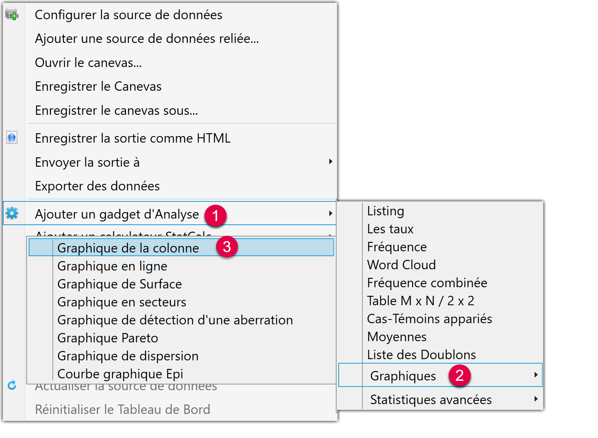{#fig-representationhistogramme}

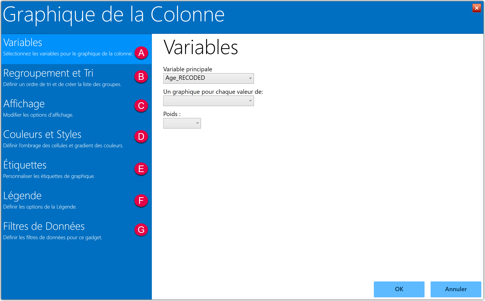{#fig-customisationhistogramme}

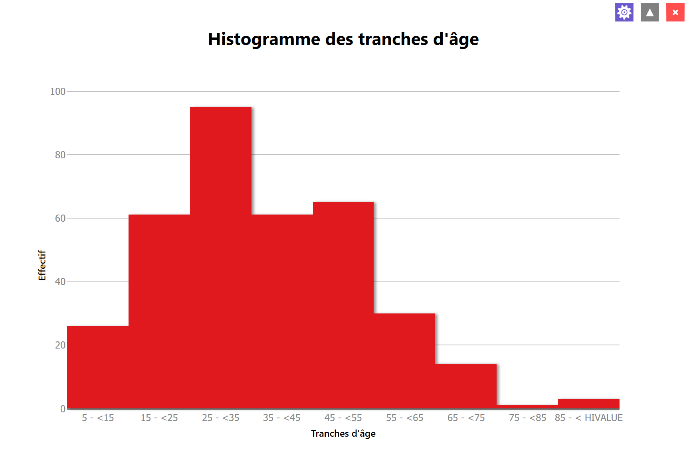{#fig-resultathistogramme}

Le graphique peut être enregistré sous forme d’image au format PNG[^05-2] (.png) ou JPEG[^05-3] (.jpg).

::: {.callout-important title="Important"}

Cette section montre qu’il est tout à fait possible de réaliser des graphiques dans Epi Info. En pratique, nous préférerons souvent exporter nos résultats vers un logiciel comme Microsoft Excel ou LibreOffice Calc, pour profiter de leurs nombreuses possibilités graphiques.

:::

## Exporter des données au format Excel ou CSV

Il est possible d’exporter les données d’Epi Info au format tableur Excel ou au format CSV[^05-4]. Pour cela, faire un clic droit sur le canevas et choisir **Exporter des données**. Une fenêtre s’ouvre. De haut en bas :

-   dans la partie **Output Mode**, laisser cochée l’option **Append** ;
-   dans **Format de sortie**, choisir le format Excel, ici **Microsoft Excel 97-2003 Workbook (.xls)** ;
-   au niveau de **Information de connexion**, cliquer sur **Parcourir**. Une fenêtre s’ouvre : vérifier que la case **First row contains header information** est bien cochée, choisir l’emplacement du fichier exporté et saisir son nom ;
-   au niveau de la **Table de destination**, saisir le nom de la table, ici `enquete` ;
-   dans **Champs à exporter**, sélectionner les champs à exporter, ou toute la base ;
-   on peut laisser cochée la case **Trier les variables par ordre de tabulation** ;
-   cliquer enfin sur **Exporter** (@fig-exportexcel).

Lorsque l’export a réussi, un message s’affiche en bas de la fenêtre, ici « Exportation terminée avec succès. 359 enregistrements écrits. »

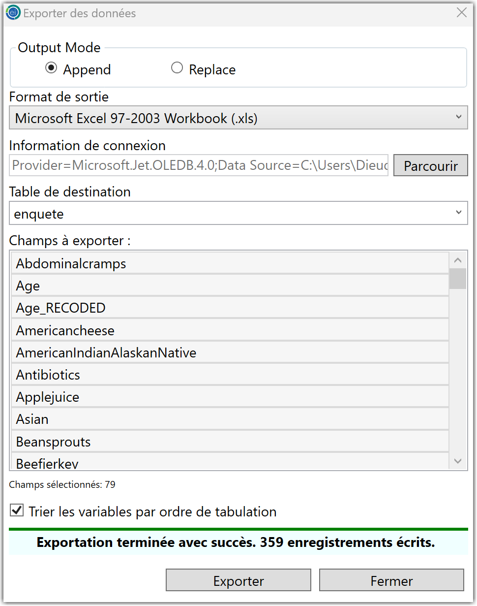{#fig-exportexcel}

::: {.callout-tip title="Conseil"}

Pour exporter au format CSV, choisissez CSV dans **Format de sortie**.

:::

::: {.callout-note title="À retenir"}

Le format **.xls** (Excel 97-2003) s’ouvre sans difficulté dans toutes les versions d’Excel et dans LibreOffice Calc. Selon les versions d’Epi Info et les composants installés sur l’ordinateur, le format plus récent **.xlsx** peut aussi être proposé ; sur les anciennes versions, il fallait installer un connecteur pour exporter aux formats Excel 2007 et Access 2007.

:::

## Copier un résultat d'analyse vers Excel

Comme nous l’avons vu, nous pouvons être amenés à transférer nos résultats vers un tableur, Microsoft Excel ou LibreOffice Calc par exemple, pour réaliser nos graphiques. Pour cela, faire un clic droit sur le gadget d’analyse concerné, puis cliquer sur **Copy data to clipboard** (que nous recommandons) ou sur **Send data to Excel**. Avec la première option, vous pouvez coller plusieurs résultats sur une même feuille Excel ; la seconde ouvre à chaque fois un nouveau classeur Excel. Testez les deux : chacune vous sera utile selon les cas.

## Sauvegarder son espace de travail {#sec-sauvegarderTableauDeBord}

Dans le module **[tableau de bord visuel]{.smallcaps}**, les gadgets d’analyse sont disposés sur le canevas : vous pouvez les déplacer, les réduire, les agrandir et les modifier.

Avant de quitter le module, que vous ayez fini ou non vos analyses, il est essentiel de sauvegarder votre espace de travail. Pour cela, cliquer sur l’icône en forme de disquette, en haut à gauche dans l’en-tête (@fig-interfacetableaubord), ou faire un clic droit sur le canevas et choisir **Enregistrer le Canevas**. Au survol de la souris, la mention **Enregistrer le tableau de bord en cours** s’affiche. Cliquer dessus, donner un nom au fichier, dont l’extension sera `.cvs7`, puis cliquer sur **Enregistrer**. Vous pouvez ensuite quitter le logiciel sans risque. Pour reprendre vos analyses, ouvrez le **[tableau de bord visuel]{.smallcaps}**, cliquez sur l’icône **Ouvrir** de l’en-tête, en forme de dossier ouvert, puis cherchez votre fichier.

Epi Info 7 est également fourni avec des tableaux de bord d’exemple, réalisés à partir des bases de données livrées avec le logiciel. Les ouvrir est un bon moyen de découvrir d’autres gadgets.

[^05-1]: La variable `Sex` compte en réalité six modalités, mais quatre d’entre elles ne contiennent aucune donnée et n’apparaissent donc pas : **A-Ambiguous**, **N-Not applicable**, **O-Other** et **U-Unknown**.

[^05-2]: *Portable Network Graphics*.

[^05-3]: *Joint Photographic Experts Group*.

[^05-4]: *Comma-Separated Values* : format de fichier texte ouvert dans lequel les valeurs sont séparées par des virgules.
