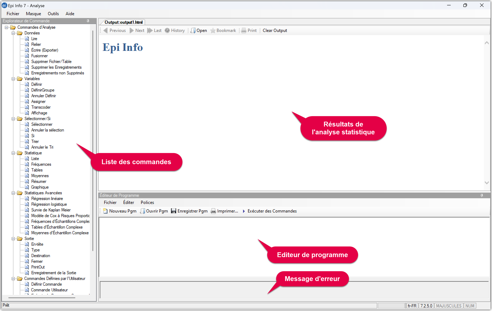
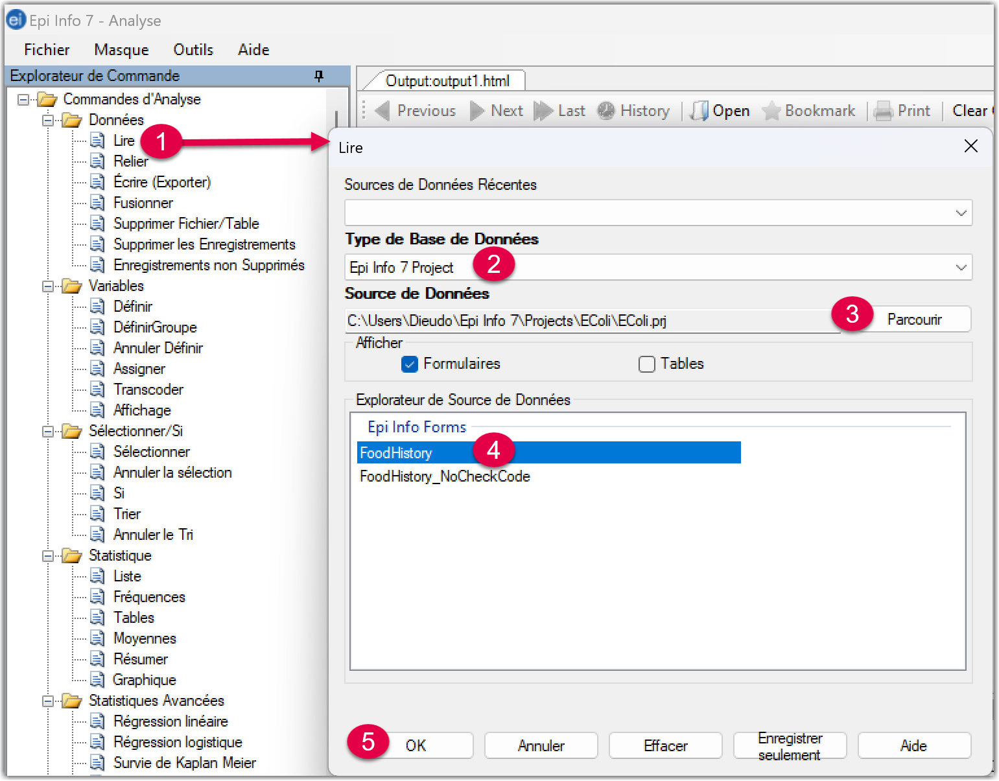
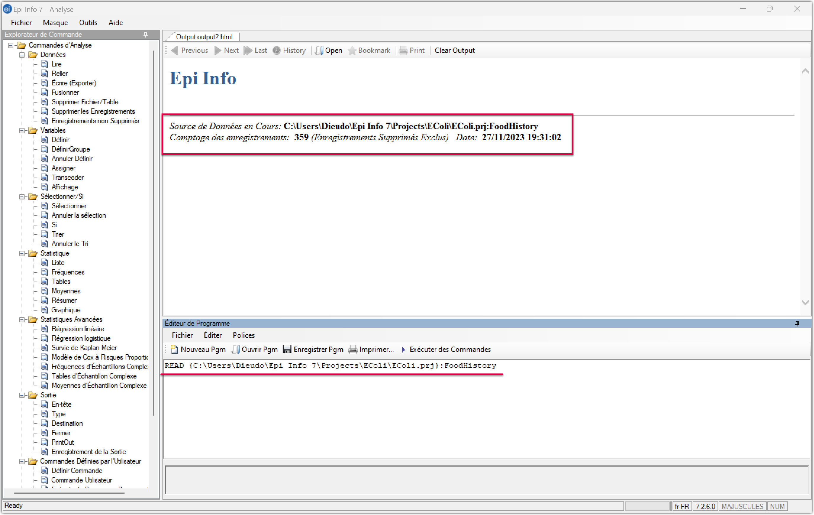
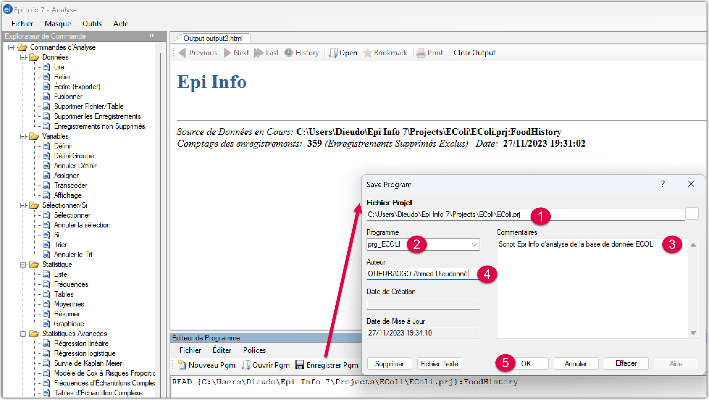

# Module Classique {#sec-moduleClassic}

Pour l’analyse des données, Epi Info 7 propose deux modules : **[tableau de bord visuel]{.smallcaps}**, étudié au chapitre précédent, et **[classique]{.smallcaps}**. Dans ce chapitre, nous apprendrons à réaliser des analyses statistiques avec le module **[classique]{.smallcaps}**, qui fonctionne à l’aide de commandes.

## Découvrir le module Classique

Pour ouvrir le module, cliquer sur **[classique]{.smallcaps}** dans la fenêtre d’accueil d’Epi Info (@fig-ouvrirmoduleclassique).

{#fig-ouvrirmoduleclassique}

L’interface du module comporte quatre parties (@fig-interfaceclassic) : à gauche, la liste des commandes, regroupées par sections ; l’éditeur de programme, où s’écrivent les commandes ; la fenêtre des résultats ; et, tout en bas, la zone d’affichage des messages d’erreur.

{#fig-interfaceclassic}

L’analyse repose entièrement sur les commandes. Elles sont regroupées en sections :

-   la section **Données** regroupe les commandes qui agissent sur les données : lecture, import et export de fichiers, fusion de bases issues d’un même questionnaire, etc. ;
-   la section **Variables** permet de créer (**Définir**), de calculer (**Assigner**), de recoder (**Transcoder**) et d’afficher (**Affichage**) des variables ;
-   la section **Sélectionner/Si** contient les commandes qui filtrent les données ;
-   la section **Statistique** permet de réaliser des statistiques simples : statistiques descriptives et tests statistiques ;
-   la section **Statistiques Avancées** permet de réaliser des analyses plus complexes : régression linéaire et logistique, analyse de survie, modèle de Cox, etc. ;
-   la section **Sortie** et les suivantes servent à paramétrer la sortie des résultats et à définir ses propres commandes.

Lorsque l’on clique sur une commande, une fenêtre s’ouvre pour la paramétrer. Après validation, Epi Info écrit la commande correspondante dans l’éditeur de programme et l’exécute. Le module **[classique]{.smallcaps}** permet de réaliser toutes les analyses du module **[tableau de bord visuel]{.smallcaps}**, et bien d’autres.

## Importer des données avec la commande Lire

Pour faciliter l’apprentissage, nous travaillerons avec la même base que dans le module **[tableau de bord visuel]{.smallcaps}** : la base `EColi`, livrée avec Epi Info. Nous pourrons ainsi comparer les résultats des deux modules.

Pour importer un fichier de données dans le module **[classique]{.smallcaps}** (@fig-commanderead), nous utilisons la commande **[Lire]{.smallcaps}** (**`READ`** en anglais) :

-   Cliquer sur **Lire** dans la section **Données** de la liste des commandes (barre latérale gauche) ;
-   Cliquer sur la flèche déroulante **Type de base de données** et choisir **Epi Info 7 Project** ;
-   Dans **Source de données**, cliquer sur **Parcourir**. Une fenêtre s’ouvre : aller dans le disque local C, puis `Utilisateurs`, puis le dossier de votre nom d’utilisateur, puis le dossier `Epi Info 7`. Ouvrir ensuite le dossier `Projects`, puis le dossier `EColi`, et enfin le fichier `EColi.prj`. Le chemin d’accès du fichier est donc de la forme `C:\Users\Dieudo\Epi Info 7\Projects\EColi\EColi.prj`, où `Dieudo` est le nom d’utilisateur ;
-   Les deux formulaires de la base apparaissent ; sélectionner le premier, `FoodHistory` ;
-   Cliquer sur **OK**.

{#fig-commanderead}

À l’issue de cette étape, nous obtenons la fenêtre de la @fig-fenetreapresimport.

{#fig-fenetreapresimport}

::: {.callout-note title="À retenir"}

Pour ouvrir un fichier Excel ou CSV, suivez la même procédure en choisissant Microsoft Excel ou **CSV file** dans **Type de base de données**.

:::

Remarquez que la commande qui a servi à importer les données est écrite dans l’éditeur de programme (@lst-read).

::: {#lst-read}

```epiinfo
READ {C:\Users\Dieudo\Epi Info 7\Projects\EColi\EColi.prj}:FoodHistory
```

Commande d'import de la base EColi

:::

## Enregistrer et rouvrir un programme

L’un des grands avantages du module **[classique]{.smallcaps}** est qu’il permet d’enregistrer les commandes de l’analyse dans un programme. On peut ainsi refaire toute l’analyse en un clic, ce qui facilite la reproductibilité, comme avec des logiciels de renom tels que [r]{.smallcaps}, [python]{.smallcaps} ou [stata]{.smallcaps}.

Pour enregistrer le programme (@fig-enregistrerprogramme) :

-   Cliquer sur **Enregistrer Pgm**. Une fenêtre s’ouvre ;
-   Dans la fenêtre **Save Program**, au niveau de **Fichier Projet**, cliquer sur le bouton à trois points situé à droite pour choisir le projet ;
-   Dans **Programme**, écrire le nom du programme, ici `prg_ECOLI` ;
-   Ajouter le nom de l’auteur du programme (votre nom) ;
-   Ajouter éventuellement un commentaire dans **Commentaires**, par exemple « Script Epi Info d’analyse de la base de données ECOLI » ;
-   Valider par **OK**.

{#fig-enregistrerprogramme}

Au fur et à mesure de l’analyse, cliquez régulièrement sur **Enregistrer Pgm** pour sauvegarder le programme.

Pour reprendre l’analyse après avoir quitté Epi Info, cliquer sur **Ouvrir Pgm**, choisir le projet puis le programme contenant les commandes. Il faut ensuite exécuter les commandes souhaitées, en commençant obligatoirement par la commande **`READ`** qui importe les données. Pour cela, sélectionnez les lignes voulues dans l’éditeur de programme puis cliquez sur **Exécuter des Commandes**, dans la barre d’outils de l’éditeur.

::: {.callout-tip title="Conseil"}

Comme dans le code de contrôle, une ligne qui commence par **`//`** est un commentaire : elle n’est pas exécutée. Commentez votre programme pour vous y retrouver plus tard.

:::

## Explorer les données

Avant de commencer l’analyse, il est utile de vérifier le type des variables. Pour cela, cliquer sur la commande **Affichage** de la section **Variables**, puis choisir d’afficher les variables de la base. La commande **`DISPLAY DBVARIABLES`** s’écrit dans l’éditeur de programme. Son exécution affiche le dictionnaire des données sous forme de tableau : pour chaque variable, son nom, la question correspondante, son type, etc. C’est une vue d’ensemble de la base.

La commande **Liste** de la section **Statistique** affiche quant à elle les données brutes, enregistrement par enregistrement. Elle permet de voir la structure des données. Le symbole **`*`** désigne toutes les variables ; on peut aussi n’en lister que quelques-unes.

::: {#lst-explorer}

```epiinfo
// Dictionnaire des données de la base
DISPLAY DBVARIABLES
// Liste de toutes les variables
LIST *
// Liste de quelques variables seulement
LIST Age Sex ILL
```

Explorer les données

:::

## Statistique descriptive

### Décrire une variable qualitative

Pour décrire une variable qualitative, nous utilisons le « tableau de fréquences », qui présente l’effectif et le pourcentage de chaque modalité. Pour l’obtenir, cliquer sur **Fréquences** dans la section **Statistiques**, sélectionner la variable dans la liste déroulante **Fréquence de**, puis cliquer sur **OK**.

Pour la variable `ILL`, nous retrouvons les résultats du chapitre précédent : 276 malades (76,88 %) et 83 non-malades (23,12 %). Le module **[classique]{.smallcaps}** ajoute l’intervalle de confiance à 95 % de chaque pourcentage.

Pour stratifier la fréquence selon une autre variable, comme le sexe, il suffit de choisir cette variable dans la liste **Stratifier par** de la même fenêtre. La commande s’écrit alors avec l’option **`STRATAVAR`** (@lst-freq).

::: {#lst-freq}

```epiinfo
// Fréquence de la variable ILL
FREQ ILL
// Fréquence de ILL stratifiée selon le sexe
FREQ ILL STRATAVAR=Sex
```

Tableaux de fréquences

:::

### Décrire une variable quantitative

Pour décrire une variable quantitative, nous utilisons la commande **Moyennes** de la section **Statistique**. Sélectionner la variable dans la liste **Moyennes de**, ici `Age`, puis valider par **OK**. Le résultat donne, comme dans le Tableau de bord, l’effectif, la somme, la moyenne, la variance, l’écart-type, le minimum, les quartiles, la médiane, le maximum et le mode.

Pour comparer l’âge selon le sexe, choisir la variable `Sex` dans la liste **Croisé par**. Epi Info affiche alors les statistiques de l’âge pour chaque sexe et réalise un test de comparaison des moyennes : l’analyse de variance (ANOVA) et, en complément, le test non paramétrique de Kruskal-Wallis, à privilégier lorsque la distribution de la variable n’est pas normale.

::: {#lst-means}

```epiinfo
// Statistiques descriptives de l'âge
MEANS Age
// Âge selon le sexe, avec test de comparaison
MEANS Age Sex
```

Paramètres de position et de dispersion

:::

## Créer et recoder des variables

### Recoder une variable

Comme dans le Tableau de bord, nous pouvons recoder l’âge en tranches d’âge. Dans le module **[classique]{.smallcaps}**, cela se fait en deux temps :

1.  Créer la nouvelle variable avec la commande **Définir** (**`DEFINE`**) de la section **Variables** ;
2.  Remplir cette variable avec la commande **Transcoder** (**`RECODE`**), en indiquant la variable source (`Age`), la variable de destination (`tranche_age`) et les intervalles de recodage.

::: {#lst-recode}

```epiinfo
DEFINE tranche_age TEXTINPUT
RECODE Age TO tranche_age
    LOVALUE - 14 = "0-14 ans"
    15 - 29 = "15-29 ans"
    30 - 44 = "30-44 ans"
    45 - 59 = "45-59 ans"
    60 - HIVALUE = "60 ans et plus"
END
FREQ tranche_age
```

Recodage de l'âge en tranches d'âge

:::

::: {.callout-warning title="Avertissement"}

Les variables créées avec **`DEFINE`** n’existent que pendant la session d’analyse : elles ne sont pas enregistrées dans la base. Elles seront recréées chaque fois que vous réexécuterez votre programme ; c’est une raison de plus pour bien l’enregistrer.

:::

### Calculer une variable avec Assigner

La commande **Assigner** (**`ASSIGN`**) de la section **Variables** affecte à une variable le résultat d’un calcul, comme dans le code de contrôle (chapitre [-@sec-codeValidation]). Créons par exemple l’âge en mois à partir de l’âge en années :

1.  Créer la variable `age_mois` avec la commande **Définir**, en choisissant le type numérique ;
2.  Cliquer sur **Assigner**, choisir la variable `age_mois` et écrire l’expression `Age * 12` ;
3.  Valider par **OK**.

::: {#lst-assignclassic}

```epiinfo
DEFINE age_mois NUMERIC
ASSIGN age_mois = Age * 12
MEANS age_mois
```

Calcul d'une nouvelle variable

:::

### Créer une variable sous condition avec Si

La commande **Si** (**`IF`**) de la section **Sélectionner/Si** exécute une ou plusieurs commandes lorsqu’une condition est remplie, et éventuellement d’autres commandes dans le cas contraire (**`ELSE`**). Elle sert souvent à créer une variable Oui/Non à partir d’une autre variable. Créons par exemple la variable `majeur`, qui vaut Oui si la personne a 18 ans ou plus :

::: {#lst-ifclassic}

```epiinfo
DEFINE majeur YN
IF Age >= 18 THEN
    ASSIGN majeur = (+)
ELSE
    ASSIGN majeur = (-)
END
FREQ majeur
```

Création d'une variable Oui/Non sous condition

:::

Le type **`YN`** crée une variable Oui/Non ; **`NUMERIC`** crée une variable numérique, **`TEXTINPUT`** une variable texte et **`DATEFORMAT`** une variable date.

::: {.callout-tip title="Conseil"}

Prenez l’habitude de vérifier chaque nouvelle variable par une commande **`FREQ`** ou **`MEANS`**, comme dans les exemples ci-dessus. Vous repérerez ainsi immédiatement une erreur de recodage ou une condition mal écrite.

:::

## Sélectionner une partie des données

La commande **Sélectionner** (**`SELECT`**) de la section **Sélectionner/Si** joue le même rôle que les filtres du Tableau de bord : les commandes suivantes ne portent que sur les enregistrements qui remplissent la condition. La commande **Annuler la sélection** (**`CANCEL SELECT`**) revient à l’ensemble des données.

::: {#lst-select}

```epiinfo
SELECT ILL = (+) AND Age >= 25 AND Age <= 35
LIST Age Sex ILL
CANCEL SELECT
```

Sélection des malades âgés de 25 à 35 ans

:::

::: {.callout-warning title="Avertissement"}

Une sélection reste active jusqu’à ce qu’elle soit annulée. Vérifiez toujours le nombre d’enregistrements affiché dans les résultats avant d’interpréter une analyse.

:::

## Trier les données

La commande **Trier** (**`SORT`**) de la section **Sélectionner/Si** classe les enregistrements selon une ou plusieurs variables, par ordre croissant ou décroissant. Le tri est utile avant une commande **`LIST`**, par exemple pour repérer les valeurs extrêmes. La commande **Annuler le Tri** rétablit l’ordre initial.

::: {#lst-sort}

```epiinfo
SORT Age DESCENDING
LIST Age Sex ILL
```

Tri des enregistrements selon l'âge

:::

## Les valeurs manquantes

Une valeur manquante correspond à un champ resté vide lors de la saisie. Par défaut, Epi Info exclut les valeurs manquantes des calculs : dans la base EColi, la moyenne des âges porte ainsi sur 356 personnes et non sur 359, car trois âges ne sont pas renseignés. Dans les commandes, une valeur manquante s’écrit **`(.)`**. On peut ainsi lister les enregistrements dont l’âge est manquant pour les vérifier :

::: {#lst-missing}

```epiinfo
SELECT Age = (.)
LIST *
CANCEL SELECT
```

Repérer les valeurs manquantes

:::

::: {.callout-important title="Important"}

Comparez toujours l’effectif d’une analyse avec l’effectif total de la base. Un écart important signale des valeurs manquantes, qu’il faut décrire et discuter dans votre mémoire ou votre thèse.

:::

## Croiser deux variables : le tableau 2x2

La commande **Tables** (**`TABLES`**) de la section **Statistique** croise deux variables qualitatives. Indiquer la variable d’exposition, ici `Icecream`, puis la variable de résultat, ici `ILL`, et valider par **OK**.

::: {#lst-tables}

```epiinfo
TABLES Icecream ILL
```

Tableau 2x2 entre la crème glacée et la maladie

:::

Pour un tableau 2x2, Epi Info affiche le tableau croisé, l’odds ratio et le risque relatif avec leurs intervalles de confiance à 95 %, ainsi que les tests du chi carré et le test exact de Fisher. Ils s’interprètent comme au chapitre précédent (section [-@sec-tableau2x2]) : une association est statistiquement significative si la valeur *p* est inférieure à 0,05, ou si l’intervalle de confiance ne contient pas 1. On retrouve ici exactement les résultats obtenus avec le Tableau de bord.

### Tableau stratifié et facteur de confusion

L’option **`STRATAVAR`**, que l’on obtient en choisissant une variable dans la liste **Stratifier par**, réalise un tableau 2x2 pour chaque modalité d’une troisième variable. Epi Info calcule alors, en plus des résultats de chaque strate, un odds ratio et un risque relatif *ajustés* sur cette variable, selon la méthode de Mantel-Haenszel.

::: {#lst-stratavar}

```epiinfo
TABLES Icecream ILL STRATAVAR=Sex
```

Tableau 2x2 stratifié selon le sexe

:::

Si la mesure ajustée est proche de la mesure brute, le sexe n’est pas un facteur de confusion de l’association entre la crème glacée et la maladie. Si elle s’en écarte nettement (de plus de 10 à 20 % selon l’usage courant), le sexe est un facteur de confusion et c’est la mesure ajustée qu’il faut retenir. Si les mesures diffèrent fortement d’une strate à l’autre, on parle de modification d’effet : il faut alors présenter les résultats strate par strate.

### Tableau MxN

Lorsque l’une des variables a plus de deux modalités, comme la variable `tranche_age` créée plus haut, la commande **`TABLES`** produit un tableau MxN. Epi Info calcule alors le test du chi carré, qui indique si la répartition de la maladie diffère selon les tranches d’âge.

::: {#lst-mxn}

```epiinfo
TABLES tranche_age ILL
```

Tableau croisé des tranches d'âge et de la maladie

:::

::: {.callout-warning title="Avertissement"}

Le test du chi carré n’est valide que si les effectifs attendus sont suffisamment grands (en règle générale au moins 5 dans chaque case). Lorsque ce n’est pas le cas, Epi Info le signale : regroupez alors des modalités ou utilisez le test exact de Fisher pour un tableau 2x2.

:::

## Représentations graphiques

La commande **Graphique** de la section **Statistique** réalise des graphiques sans quitter le module : diagrammes en barres, en secteurs, histogrammes, courbes, etc. Dans la fenêtre qui s’ouvre, choisir le type de graphique, la variable à représenter et, si besoin, une variable de regroupement, puis valider par **OK**. Le graphique s’affiche dans une fenêtre séparée, d’où l’on peut l’enregistrer comme image. Comme pour le Tableau de bord, nous préférerons souvent réaliser les graphiques définitifs dans un tableur.

## Exporter et fusionner des données

### Exporter des données

La commande **Écrire (Exporter)** de la section **Données** enregistre les données, avec les variables créées pendant l’analyse, dans un autre fichier : base Epi Info, classeur Excel ou fichier CSV. Dans la fenêtre qui s’ouvre, choisir les variables à exporter (ou toutes les variables), le format et l’emplacement du fichier, puis valider par **OK**. Si une sélection est active, seuls les enregistrements sélectionnés sont exportés.

### Fusionner deux bases

Lorsque plusieurs enquêteurs ont saisi des données sur le même questionnaire, il faut les rassembler dans une seule base. La commande **Fusionner** de la section **Données** réunit la base en cours, ouverte avec **`READ`**, et une seconde base. Elle peut ajouter les enregistrements de la seconde base à la suite de ceux de la première, ou compléter les enregistrements existants à l’aide d’une variable d’identification commune.

::: {.callout-note title="À retenir"}

La fusion n’est simple que si toutes les bases proviennent du même questionnaire. C’est l’intérêt d’envoyer à tous les enquêteurs le même modèle de projet (section [-@sec-modeleProjet]).

:::

## Aller plus loin

### Enregistrer les résultats

Par défaut, les résultats s’affichent dans la fenêtre de résultats et sont perdus à la fermeture du module. La commande **Destination** de la section **Sortie** (**`ROUTEOUT`**) envoie les résultats dans un fichier HTML, que l’on peut ouvrir dans un navigateur, imprimer ou copier dans un traitement de texte. La commande **Fermer** de la même section (**`CLOSEOUT`**) ferme ce fichier.

::: {#lst-routeout}

```epiinfo
ROUTEOUT "C:\Users\Dieudo\Documents\resultats_EColi.html" REPLACE
FREQ ILL
MEANS Age Sex
TABLES Icecream ILL
CLOSEOUT
```

Enregistrer les résultats dans un fichier

:::

### Les statistiques avancées

La section **Statistiques Avancées** donne accès à des modèles plus complexes. Les plus utilisés sont :

-   la *régression logistique* (**Régression logistique**), lorsque la variable à expliquer est binaire (malade/non malade). Elle estime des odds ratios ajustés, c’est-à-dire l’effet propre de chaque facteur en tenant compte des autres, comme nous l’avons évoqué au chapitre précédent ;
-   la *régression linéaire* (**Régression linéaire**), lorsque la variable à expliquer est quantitative (le poids, la pression artérielle…) ;
-   l’*analyse de survie* (**Survie de Kaplan Meier** et **Modèle de Cox à Risques Proportionnels**), lorsque l’on s’intéresse au délai de survenue d’un événement, comme le décès ou la guérison.

Par exemple, pour mesurer l’effet de la crème glacée sur la maladie en tenant compte de l’âge, cliquer sur **Régression logistique**, choisir `ILL` comme variable de résultat, `Icecream` et `Age` comme variables explicatives, puis valider par **OK**.

::: {#lst-logistic}

```epiinfo
LOGISTIC ILL = Icecream Age
```

Régression logistique

:::

Le résultat donne, pour chaque variable explicative, un odds ratio ajusté avec son intervalle de confiance à 95 % et sa valeur *p*, qui se lisent comme ceux d’un tableau 2x2.

Ces méthodes demandent de solides bases en biostatistique ; prenez le temps de les maîtriser avant de les utiliser pour votre mémoire ou votre thèse.

## Récapitulatif des commandes essentielles

Le @tbl-commandesClassique rassemble les commandes du module **[classique]{.smallcaps}** vues dans ce chapitre.

| **Commande** | **Bouton (section)** | **Rôle** |
|:---|:---|:---|
| `READ` | Lire (Données) | Ouvrir une base de données |
| `DISPLAY DBVARIABLES` | Affichage (Variables) | Afficher le dictionnaire des données |
| `LIST` | Liste (Statistique) | Lister les enregistrements |
| `FREQ` | Fréquences (Statistique) | Tableau de fréquences |
| `MEANS` | Moyennes (Statistique) | Statistiques d'une variable quantitative |
| `TABLES` | Tables (Statistique) | Tableau croisé, OR, RR, chi carré |
| `DEFINE` | Définir (Variables) | Créer une variable |
| `ASSIGN` | Assigner (Variables) | Calculer une variable |
| `RECODE` | Transcoder (Variables) | Recoder une variable |
| `IF` | Si (Sélectionner/Si) | Exécuter des commandes sous condition |
| `SELECT` | Sélectionner (Sélectionner/Si) | Filtrer les enregistrements |
| `SORT` | Trier (Sélectionner/Si) | Trier les enregistrements |
| `LOGISTIC` | Régression logistique | Odds ratios ajustés |
| `ROUTEOUT` | Destination (Sortie) | Enregistrer les résultats |

: Commandes essentielles du module Classique {#tbl-commandesClassique}
